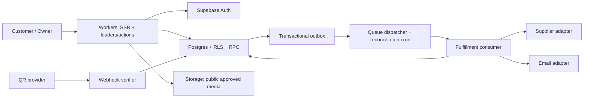

# Hubby — Architecture proposal

02/11/2026 implementation: existing Worker uses payOS verified settlement + encrypted stock delivery, extended by private supplier_bindings/supplier_jobs/supplier_audit and service-only RPCs. Bite checkout stores immutable per-unit source obligations (not fake stock), then verified paid orders can make one non-idempotent purchase per job. Received ciphertext becomes real reserved stock and uses existing customer isolation/fulfillment; ambiguous purchases require Owner reconciliation. CMS/price/draft schema is unchanged. Runtime purchase flags enabled by explicit Owner request; missing key/mapping still blocks source checkout. docs/BITE_PAYOS_LIVE.md records deployed state and limitations.

Current decision 02/11/2026: WordPress/WooCommerce migration cancelled by Owner. React Router SSR on Cloudflare Workers + Supabase remains the only active shop architecture, preserving the original design and custom CMS. Budget 0 VND. The wordpress/ prototype and migration proposals below are historical only; do not create hosting or two parallel order/catalog systems. Implement payment/supplier services within existing server/domain/repository boundaries.

OCB/Casso request22/10/2026: Owner has no OCB/Casso accounts. Add isolated Casso V2 verifier (sorted full-envelope HMAC-SHA512, unlike SePay), exact OCB/main-account/CASS VA, trusted VND/test-live binding and strict order matching. Receipt/store orchestration exists only as contract, not durable settlement. Reserved /webhooks/casso always returns POST503/success=false until reviewed atomic inbox/settlement/outbox implementation and private account setup/UAT. Checkout stays closed; no remote DB, new resources or provider account mutation. docs/OCB_CASSO_SETUP.md records actual work, pricing evidence and Owner/Codex tasks.

Custom domain update12/10/2026: https://hubby.dpdns.org now maps to the existing Worker, Cloudflare Free, with independent workers.dev backup. Exact server-configured SITE_ALIAS is resolved per request into SITE_ORIGIN, never wildcard/forwarded Host; host cookies and CSRF remain isolated. Hosted provider callback allowlists remain a separate verified setup gate. See docs/CUSTOM_DOMAIN.md.

## Public hosting / SePay boundary — 12/10/2026

Worker `hubby` is deployed at https://hubby.kienhoang1919.workers.dev, version `c2f44d4e-a769-45e1-a4de-b73f8764f854`, verified Free. Hosted SSR excludes local simulator bindings. Seven guarded invoker RPCs serve ownership-scoped orders/support and private submissions; elevated private implementations own atomic writes, CAS replies and bounded anonymous submissions. Normal previews remain isolated.

SePay raw-byte HMAC verifier and order eligibility are implemented/tested, but **not** a routed/enabled/acknowledged live-money integration. Durable receipt, reservation, settlement, reconciliation, encrypted delivery/outbox and test/live separation remain necessary. No service key, bank identifier or webhook secret put in source. See docs/SEPAY_SETUP.md. A publicly deployed staging configuration is not acceptance for paid commerce.

## Isolated hosting build — 12/10/2026

The local entry workers/app.ts exports the sandbox DO and the shared request handler. workers/hosted.ts exports only that handler; wrangler.hosted.jsonc has no local DO migration/binding or fixture inventory key. A fixed local-only hosting-build wrapper selects HUBBY_BUILD_TARGET=hosted-staging, separate Vite configPath and React Router buildDirectory=.wrangler/hosted-build. Default npm build/check/preview retain original local artifacts and state. No provider credentials are read by this wrapper; no upload occurs. Server headers/cookie accumulation use one unchanged shared handler. Existing privileged .server boundaries, trusted membership and fail-closed production config remain.

Hosted source deliberately lacks unverified service key/site origin and leaves public routing disabled. hosting:preflight redacts values and detects local/production/live-mode mixups, fixture/unknown vars, DO migrations, invalid URLs/keys and unreviewed routes. Config acceptance is not account/plan/permission/UAT/CPU/restore acceptance. It is a diagnostic, not an enforcement wrapper around arbitrary manual Wrangler deploy. Actual artifact built successfully; public deployment remains pending.

Verified primary references: [Cloudflare Vite configPath API](https://developers.cloudflare.com/workers/vite-plugin/reference/api/#interface-pluginconfig), [React Router buildDirectory](https://reactrouter.com/api/framework-conventions/react-router.config.ts#builddirectory). These options apply during build; supplying a different environment only at deployment is not a substitute for a reviewed generated artifact. Supabase/CMS state is unchanged.

## Owner-approved password-only admin — 12/10/2026

private.owner_access_policy is a singleton RLS-enabled deny-all table; application roles, including service_role grants, cannot read/write it. Migration initializes no exception. Trusted operator deliberately binds password_only_issuer to the configured Auth project after Owner's explicit live-scope risk acceptance. Private owner_status exposes mfa_required plus issuer; SSR permits opt-out only for strict false and exact configured issuer after getUser. Private hubby_owner still checks active trusted membership and requires signed authenticated/nonanonymous AAL1 from that issuer, or genuine AAL2. Public RPCs remain invoker wrappers, all CMS/Storage policies reuse guarded private logic. No JWT assurance-level fabrication or client metadata authority. Missing policy/mismatched project retains MFA; null issuer restores MFA. Existing deployment/payment gates remain distinct from this login decision. [Supabase JWT verification/claims](https://supabase.com/docs/guides/auth/jwts).

## Application URL versus transport URL — 12/10/2026

React Router8 handler url is authoritative for app pathname/query: it strips Single Fetch .data/index/_routes. request.url remains raw and is retained for origin/protocol/security checks only. Shared auth actions previously fell from enhanced /dang-ky.data into password login; normalized dispatch now fixes signup, recovery, logout and reset. Callback/confirmation/MFA loaders and admin/customer/legacy navigation use the same contract. Admin login/MFA next preserves app section query without transport parameters. Verified with38 offline auth cases and actual Workers invalid-signup transport POST; this is not live signup/confirmation/MFA acceptance. [Official API](https://api.reactrouter.com/v8/interfaces/react-router.ActionFunctionArgs.html).

## Provider availability and email setup — 12/10/2026

Server reads the public Auth settings with publishable key, bounded5s timeout and per-request memoization. Root loads identity, public settings and CMS in parallel; only strict external provider booleans reach UI. This status never authorizes roles/MFA: getUser+private membership/AAL2 remain mandatory. Disabled Google is blocked on direct POST as well as UI. Signup/recovery provider configuration/rate failures return503, not a claimed email success; account-existence responses remain generic. Offline tests disable network and check malformed responses/failures/origin/metadata boundaries.

Owner manually saved origin5176 and exact customer/recovery callback URLs; verified via visible Dashboard. Default SMTP restricts delivery to project-team addresses and current Dashboard blocks template editing without custom SMTP. Prepared HTML templates use token_hash → app GET landing → CSRF POST consume, but are not applied to service. No custom SMTP/domain/Google secrets, real user/password/MFA or production resources created. Default-template PKCE must use the same browser and does not satisfy scanner-safe production email acceptance. Owner self-signup/confirmation is now a necessary credential handoff, followed by explicit verified-UUID bootstrap.

## Current CMS staging bridge — 12/10/2026

Forward migration supports optional experience, product terms, priceConfigured and managed announcement/slide media while retaining strict legacy validation, immutable snapshots, Owner+AAL2 and public invoker wrappers. Private helpers cannot be called by app roles. Media publication checks both metadata and a real bucket object; removal revokes anonymous access. Normalized product terms and variant price_configured mirror the published payload; demo_stock remains synthetic, never real inventory.

Current published local-14 content was schema/hash reviewed, then imported atomically into previously untouched staging (no users/revisions/products). Source SHA256 d0011f958db9d6a7060fc4c4494ae7a6bfbff81c96fb6f30a7144aff8eb752f7. No images/public reviews in this snapshot, so no silent media loss or unverified testimonials. Bootstrap revision staging-import-1 has null author and immutable staging_content_import audit; no fake actor or cms_publications row. Future authenticated publications retain normal audit requirements. An untouched-target guard forbids repeating bootstrap.

Isolated loopback5176 now runs Workers SSR with real Supabase catalog;5174 remains local. Auth service reachable, but no Owner/user yet and Google disabled. Real URL/template configuration, email/MFA/Storage/commerce acceptance pending. No production guard removed, remote website deployment, paid upgrade or live payment enabled. Earlier foundation-only/local-only extension statements below are historical.

## Isolated staging foundation — 12/10/2026

Verified Owner-created hubby-staging (Hubby Free, ap-southeast-1, PostgreSQL17.11). Empty application schemas/migration history/Auth users/Storage baseline; no existing application data to overwrite. Applied exact Phase2 schema plus a forward ACL/index migration after PGlite tests. Supabase default grants exposed additional anon function execution despite PUBLIC revocation: moved privileged implementations into private and kept public signatures as invoker wrappers; private schema is not exposed via REST, tables explicitly revoked and RLS deny-all. Private wrappers/helpers retain trusted membership and AAL2 checks; published read is intentionally a minimal public projection. Do not add permissive policies just to silence private deny-all advisor info. Foreign keys indexed and Auth RLS expressions initplanned. Anonymous REST checks verify no Owner/profile/draft/CMS mutation access; they do not prove signed-in A/B or MFA.

Connection settings prepared in ignored .dev.vars.staging using publishable key only, separate from normal local preview. No database password, secret key, Auth user, historical fixture seed, current CMS import or real commerce data stored/sent. Default5174 stays local fixtures; no staging web server/deployment yet because latest optional CMS fields are not accepted by the original SQL validator. Next: compatible current CMS schema/materialization + guarded import, then isolated web/Auth/MFA/Storage UAT. Production guard remains; all payments/suppliers mock. See docs/STAGING_SETUP.md for actual results.

## Minimum-spend deployment request — 12/10/2026

Owner now requests hosted completion, minimum spend, TPBank, no provider accounts yet. Start current-stack free staging; do not buy Pro/Paid automatically. Workers Free is a CPU-measured candidate (10ms), not accepted hosting. Oracle Always Free verified current2 OCPU/12GB with capacity/idle-reclaim/card/no-SLA constraints; self-host/public endpoints/ARM/runtime have not passed a spike. No switch, account, resource or deploy performed. Existing production guard remains. See docs/LOW_COST_RELEASE.md for conditional costs, one Owner setup step and Codex release backlog; older "VPS not chosen"/Pro recommendation is historical comparison, not a new cost commitment.

## Admin-account entry clarification — 12/10/2026

After password login, PKCE exchange or POST email confirmation, invalidate per-request identity cache and verify `getUser` + trusted `owner_status` again. Default customer destination stays `/tai-khoan`; verified Owner destination is `/admin`, with AAL1 sent through `/xac-thuc`. Recovery/cart returns are preserved and `safeNext` rejects external destinations. Root exposes only a verified membership boolean for navigation; that boolean is not authorization. `/admin` loaders/actions and database policies still independently require Owner+AAL2. Account/logout menu uses POST+CSRF; logout failures never claim success. Provider mocks validate routing/guards offline, not GoTrue/MFA acceptance. No migration, credentials, provider configuration or production resource created. Real administrative commerce backend is still pending.

Catalog v3: six Owner-defined products, seven unpriced variants with server rejection until configured; optional typed terms/priceConfigured remain local-only pending SQL migration. Separate POST /review validates product/rating/text/CSRF, stores privately through existing feedback limits/dedupe; no public testimonials generated. Existing loopback simulator restrictions remain. See docs/CATALOG_V3.md.

## Current local continuation (11/10/2026)

Storefront refresh: optional strict `experience` CMS extension provides stable IDs, intro/notices/slides/approved reviews/illustrative-toggle/plain Telegram link. Old immutable snapshots get non-mutating render defaults; only exact legacy fixture copy is adapted, Owner custom copy retained. Extension is rejected for Supabase publish until migration; no silent incompatible staging writes. Root verified Auth status controls account UI; login modal reuses server CSRF actions, unconfigured local fields disabled. Order lookup queries only server-owned session orders; email is fixed synthetic address, not identity evidence. Support POST validates CSRF/body/schema and owned order before ticket; no bot token/client secret/external messaging. No public credentials API based on code/email.

Supersedes historical browser-only CMS notes below: with the local binding enabled, Worker BFF → loopback-only LocalShop Durable Object → SQLite ledger/CMS/guest sessions/limits. CMS CAS publish and commerce transitions use synchronous storage transactions. Preview state lives outside build at `.wrangler/hubby-preview-state`; dev has separate state. Copy checksum and rebuild/restart continuity verified, not a backup restore drill.

Server pricing snapshots published variants and reserves all units atomically. Deduplicated mock payments create one retryable fulfillment job; delivery assigns once; full refund cancels pending jobs and retires units. Guest ownership uses a random HttpOnly cookie hashed server-side, expires24h; no email proof or registered identity. Operations is a public loopback simulator, never Owner authorization. AES-GCM fixture key is public: no real secrets allowed. Mock payment/supplier contracts are tested without external calls, bank QR or production delivery. Supabase normalized commerce, private operations and queue/staging integrations remain open. See docs/LOCAL_HANDOFF.md.

Local runtime was checked against the official [SQLite storage API](https://developers.cloudflare.com/durable-objects/api/sqlite-storage-api/) and [storage practices](https://developers.cloudflare.com/durable-objects/best-practices/access-durable-objects-storage/). No namespace was deployed or hosting bill created.

Ngày kiểm chứng: 11/10/2026 (Asia/Saigon). Trạng thái: chọn stack phát triển; production gate chưa đạt. Không dịch vụ cloud nào đã được tạo.

## 1. Lựa chọn kỹ thuật

**Đề xuất cuối cho MVP:** React Router 8 Framework Mode SSR + React + TypeScript + Vite, chạy Cloudflare Workers qua plugin chính thức. Supabase PostgreSQL + Auth + Storage; Supabase JS HTTP/PostgREST và SQL RPC cho transactions; không ORM/direct TCP trong MVP. CSS tokens/components riêng; CMS trong cùng ứng dụng. Email qua adapter Resend (SMTP cho Auth sau cấu hình). QR adapter ưu tiên SePay nếu tài khoản/bank/phí phù hợp; payOS là lựa chọn thay thế. Workers Queues + transactional outbox cho fulfillment/email; cron đối soát và re-dispatch. GitHub cho versioning/CI, local Windows là nơi phát triển.

Free Supabase dùng phát triển/staging. Production khuyến nghị Pro; nếu giữ dưới 500.000đ thì chỉ cân nhắc pilot giới hạn trên Free sau khi Owner chấp nhận rõ pause/quota/backup tự quản và restore test đạt. Không trình bày Free như phương án production tương đương Pro.

Chưa lắp Auth/DB/payments/queue SDK vào skeleton; chỉ SSR shell, domain types/adapter contracts, checks. Phiên bản npm chính xác và lockfile là bằng chứng compatibility thực tế; không dựa trên snippet framework cũ.

## 2. Kiểm chứng tài liệu chính thức

| Chủ đề | Kết luận đã kiểm chứng | Ảnh hưởng |
| --- | --- | --- |
| React Router + Workers [S1] | Guide chính thức hiện hướng dẫn v8, SSR và Cloudflare Vite plugin; SPA/prerender không hỗ trợ với integration đó | Chọn SSR, không hứa SSG; build/local Workers phải chạy |
| Workers quota [S2,S3] | Free 100k req/day, CPU 10ms; Paid tối thiểu $5/mo, 10m requests/30m CPU-ms included | Free chỉ dev; benchmark SSR trước mở bán; không coi network wait là CPU |
| Supabase integration [S4] | Supabase JS được hỗ trợ; direct Postgres thì có Hyperdrive | HTTP client + RPC đủ MVP, chưa cần thêm connection layer |
| Supabase Auth SSR [S5] | Cookie session + PKCE; @supabase/ssr vẫn beta trong docs | Pin package, integration tests cookie refresh/OAuth; không trust session chỉ đọc cookie |
| Auth/RLS [S6,S7] | MFA hỗ trợ; RLS cho bảng exposed, service credentials có thể bypass | Owner check role+AAL2 server; secrets không gửi browser |
| Supabase plans [S8] | Free 500MB DB, 1GB storage, 5GB egress, 2 active projects, pause sau 1 tuần inactive; Pro từ $25, additional project từ $10 | Budget constraint thực; region và staging tách riêng |
| Backups [S9] | Free tự export; paid backups, DB restore không phục hồi file objects Storage | Backup DB + media + key versions tách riêng; restore drill |
| SePay [S10,S11] | Free 50 transactions/mo, Startup hiển thị 120.000đ/mo; webhook auth HMAC/API key, transaction id dedupe, test payload | Phải xác nhận bank/overage/quota; chọn HMAC khi supported, không nhầm test event với tiền thật |
| payOS [S12,S13] | QR/payment status/webhook signature HMAC; docs liệt kê production API; các trang phí/ưu đãi không đủ để hứa free vĩnh viễn | Adapter thay thế, verify eligibility/fee; mock trước, không tự gọi production |
| Resend [S14] | Free 3k emails/mo, 100/day; Pro $20/mo | Tính cả auth/receipt/recovery; email outbox quota/retry |
| Queues [S15] | Free 10k ops/day / 24h retention; Paid 1m ops/mo, thường 3 ops/message | Không bảo đảm exactly-once; DB outbox là recovery source |

Official docs + npm đã xác nhận RR 8.4.0, Cloudflare plugin 1.63.1 (Vite 6/7/8, Wrangler >=4.149), RR dev 8.4 hỗ trợ Vite 7/8, TS 5/6/7. Pinned stack đã qua local typecheck/tests/build và Workers HTTP smoke. RR8 dùng RouterContextProvider/createContext; skeleton truyền env/ctx qua typed runtimeContext (không copy plain context object ví dụ cũ). [Server entry docs](https://reactrouter.com/api/framework-conventions/entry.server.tsx) yêu cầu custom entry khi dùng Cloudflare; skeleton dùng Web ReadableStream, không Node pipe. Performance và production latency chưa được đo.

## 3. Các phương án so sánh

| Phương án | Điểm mạnh | Đánh đổi | Kết luận |
| --- | --- | --- | --- |
| Workers + RR + Supabase | Postgres transaction/RLS/Auth/MFA/media managed, SSR native integration | Pro vượt budget; thêm round trips edge → region | Chọn cho MVP; gate cost production |
| Workers + RR + D1 + R2 + managed external Auth | D1/Workers quotas tốt, Time Travel [S16,S17]; chi phí lưu trữ thấp | Thay RLS/auth ownership/MFA, SQLite transaction semantics, thêm Auth provider và migrations | Backup option khi hard cap; chưa thay stack khi chưa có budget decision |
| Next.js/Vercel + Supabase | Node/framework ecosystem, workflow phổ biến | Vercel Hobby chỉ personal non-commercial; Pro $20/mo [S18] cộng DB | Không hợp target budget |
| VPS + Postgres/self-host Auth | Có thể kiểm soát chi phí base | Patch/monitor/backup/mail/on-call tự quản; không đạt managed preference | Không chọn |

D1 không thay Supabase một cách cắm vào là chạy: cần spike auth/MFA/atomic stock/restore và cập nhật DATABASE trước đổi. Không tự xây password hashing/auth để né chi phí.

## 4. Chi phí vận hành

USD→VND dùng **giả định tính toán 26.000đ/USD**, không phải tỷ giá đã tra; phải thay bằng rate/thẻ/VAT thực tế lúc mua. Dự toán tải nhỏ: <=1m dynamic requests/mo, <=50 giao dịch/mo pilot, <=3k emails/mo và <=100/day, media <=1GB, DB <=500MB, queue <=100k ops/mo. Domain giả định 300–600k/năm (25–50k/tháng), chưa chọn TLD/báo giá.

| Kịch bản | Workers | DB/Auth/media | Payment | Email/queue | Tổng base dự kiến |
| --- | --- | --- | --- | --- | --- |
| Local Phase 0–1 | 0 | Fixtures | Mock 0 | Mock 0 | 0đ |
| Staging free, synthetic only | 0 | Supabase Free 0 | Mock 0 | Free/quota | 0–50k nếu mua domain |
| Pilot Free DB | $5 ~130k | 0 | 0 nếu đủ Free quota / 120k base Startup | Free nếu quota đủ | 155–300k + backup/overage/tax |
| Recommended production 1 Pro project | $5 ~130k | $25 ~650k | 0–120k base | Free nếu quota đủ | 805–950k + backup/overage/tax |
| Production + paid staging project | như trên | +$10 ~260k | như trên | như trên | 1.065–1.210k + extras |

Đây là base scenario, không phải cam kết dưới 500k. Pilot dành tối đa 100k dự phòng backup/overage → khoảng 255–400k chưa VAT/card; 50 SePay transactions không nhất thiết bằng 50 orders (cần xác nhận event counting/bank activity). Nếu email vượt quota và cần Resend Pro, thêm ~520k. Provider overage chưa có báo giá xác thực cho tài khoản cụ thể: không suy đoán. Không tính phí mua inventory, thuế thương mại, công Codex, domain upfront hoặc supplier vào base hosting; Owner phải tính riêng cash flow.

Alerts đề xuất ở 250/350/450k forecast; cost report weekly và quota email/DB/payment daily. Không tự cắt webhook đang xử lý tiền để giữ budget; khi gần cap có thể ngừng checkout mới, vẫn xử lý/reconcile đơn đã nhận. Nâng Supabase Pro khi nhu cầu uptime/backup/size/egress đòi hỏi; nếu hard cap không thay đổi thì release bị gate cho đến khi alternative spike đạt.

## 5. Topology và boundaries

Public catalog may use publish-version cache. Account/admin/order/reveal/Auth responses `Cache-Control: private, no-store`; no secrets in SSR loader/public projections or static assets. Webhook BFF route raw body cap 64KB, supplier call bounded timeout, no long job tied to browser response. Queue payload IDs only; fetch encrypted delivery in consumer, never plaintext messages. Auth/reset callback cookies must survive every Set-Cookie header.

Backend split into catalog, cms, identity, checkout, payments, inventory, fulfillment, support, reporting, audit modules. Shared public types cannot import `.server.ts` modules. Server services use repositories and provider interfaces; runtime supplies config per request, no global mutable customer session.

## 6. Auth, guest access, secrets

- Supabase handles password/Google; authorize JWT with supported verified claims/user API, enforce expiry and identity; no client role metadata grants. Role membership server-managed, Owner bootstrap trusted manual procedure; verify AAL2 for all admin operations including media/CMS and secret reveal.
- RLS deny by default. Customer reads own orders/tickets/purchases/wishlist; public only published catalog projection; guest no direct table access. Service role used only server and restricted workflows with explicit ownership checks. RPC permissions revoked from public where privileged; SECURITY DEFINER fixed search_path, allowlist, no user-supplied SQL.
- Guest: 256-bit random token, hashed at rest, scoped order+email, short expiry (propose 15m), one-use exchange on POST into HttpOnly secure same-site order session. GET landing does not consume token (mail scanner); no order-secret lookup by email+code alone; generic resend response; rate limit. Link page no third-party resources and Referrer-Policy no-referrer. Optional signed-in claim only after verified same email + explicit claim transaction, never match unverified email.
- Encryption application-side AES-256-GCM with unique random nonce, AAD record/variant identifiers, key version. Key material in Workers secrets outside DB; key rotation background decrypt/re-encrypt with dual-version read, old key retained until backup restore window expires. Different keys per staging/prod. Never log raw inventory/activation/supplier secrets. Media is not secret storage.
- CSRF token + Origin allowlist on cookie-based writes; OAuth PKCE/state protections, output escaping/sanitization, CSP allowlist, no arbitrary CMS scripts. Turnstile/edge rate limits plus server/DB limits login/recovery/checkout/reveal/tickets; do not rate-limit by IP alone.

## 7. Checkout, payment and fulfillment consistency

1. Server validates variant+qty+activation schema; recomputes VND totals/coupon. Checkout idempotency key + request hash returns same order on retries, 409 if same key different request.
2. One SQL transaction locks variant/coupon as needed, reserves inventory with `FOR UPDATE SKIP LOCKED`, creates immutable order/item price snapshots/payment intent and coupon hold. Full qty reserve or rollback. Local inventory is stored encrypted in DB, not Windows disk; Windows CSV source is import input only.
3. Provider link creation is external to transaction: stable merchant reference/idempotency key, store attempt; timeout → query provider before creating another. Frontend sees pending/error and cannot alter financial state.
4. Webhook verifies provider-specific canonicalization/HMAC and env/channel/account/inbound/currency/reference/amount; authenticated replay rejected by unique transaction constraint, not in-memory cache. If signature carries timestamp enforce documented replay window; otherwise dedupe event/transaction and reconcile. Provider setup/test payload must not settle a real order.
5. Transaction stores event/transaction, locks payment+order, performs conditional state transition, commits outbox and coupon consumption. ACK only after durable commit; duplicate committed event ACK safely. Under/over/late/unknown payment recorded for review, not automatically delivered; default no partial payment accumulation until policy approved. Raw payload encrypted/restricted with short retention, never standard logs.
6. Queue dispatcher publishes outbox event IDs, records dispatch but crash may resend. Consumer uses DB lease + stable unit idempotency key. Local fulfillment atomically commits reservation→assigned + fulfillment record; delivery availability derived from committed record. No second allocation on replay. Notification separate outbox; email failure never reallocates stock.
7. Supplier calls cannot share DB transaction. Store attempts/key/reference before call; on timeout status `uncertain`, reconcile lookup; if supplier cannot lookup/idempotency, move manual review, never blind retry or switch supplier. Automatic failover only before supplier purchase known absent. Activation can wait for customer input; paid state preserved.
8. Expiry/release job locks same order/payment as webhook; expired paid order becomes review if stock already released. Periodic provider polling recovers missed webhooks and persists same dedupe path. Unmatched deposit has ledger entry/alert, no fictitious order.

Order/payment/fulfillment states separate (DATABASE); paid order not automatically delivered. Replacement is a new fulfillment generation linked to prior allocation, not reset old stock; secret already revealed stays unavailable. Refund initiated/confirmed states follow actual bank/provider capability, manual evidence review for transfer refunds; not just change order badge.

## 8. Operations and launch gates

Local synthetic fixture → isolated staging synthetic DB/key/provider → UAT → explicit production approval. Staging provider network disabled by default; no claim payOS sandbox exists (official API lists production). Request supported sandbox/test mechanism separately. No production IDs/secrets in staging or CI; tests block outbound provider calls by default.

Private backup export every 24h (pilot target), encrypted offsite with 7 daily +4 weekly retention proposed, media manifest/objects and encryption key recovery protected separately. Supabase Free requires owned runner/job; scheduling/restoring not implemented Phase 0. Paid daily DB backup also needs media/key backup. Restore to isolated DB and verify orders/ledger/allocated inventory, then reconcile externally after outage before resuming fulfillment. RPO24h means recent payments may need provider-ledger reconstruction; never reissue inventory blindly after restore.

Logs structured event IDs/result/duration, redacted error messages; Owner audit append-only; alarms webhook failures, unfulfilled paid age>5m, stock low, supplier uncertainty, backup missed, quota. Kill switches checkout/payment adapter/supplier consumer independent. Health endpoint only says runtime alive; no DB/payment health implied.

GitHub CI quality checks only. No deployment workflow, Cloudflare account ID, remote bindings or real secrets in Phase 0. Git workspace initialization is local; publishing is a separate workflow. Rollback app compatible with migrations; expand-contract DB migrations and restore drill before release.

## 9. Owner vs Codex

Phase 1 implementation (11/10/2026): Workers SSR chạy local, không đổi stack hoặc tạo remote bindings. `app/content/types.ts` định nghĩa contract và `app/content/fixtures.ts` cung cấp content/synthetic catalog; UI/domain catalog/cart tách riêng để thay provider ở Phase 2. Browser storage chỉ giữ product/variant IDs và quantity; checkout confirmation là ephemeral UI, không order/payment record. Giá/tồn kho fixture chỉ phục vụ demo, không cơ chế xác thực thương mại. CMS DB, auth, RLS, order transactions, encryption và adapters thật chưa triển khai. `npm run preview` phục vụ bản build bằng Wrangler local trên loopback; không deploy.

Product-first revision: fixture schemaVersion2 replaces hero with compact shop fields, adds home URL-based search/category filtering through the existing pure catalog domain. Four Owner-requested brand examples replace fictional products; no provider SDK, service claims or remote brand assets added. Old invalid cart IDs are rejected by normalizeCart; stale wishlist IDs are filtered against current fixtures. This is a content contract revision only, not a SQL/database change.

Owner: choose budget risk/production plan, bank/provider/supplier contracts, account ownership/MFA, secret provisioning, domain, UAT and explicit release approval.

Codex: implement and validate design/schema/RLS/RPC/adapters, local tooling/CI, mock payments, recovery/reconciliation runbooks, staging plan, cost alarms. Prove production gates with evidence before proposing release.

## Sources (official, accessed 11/10/2026)

- S1 [Cloudflare React Router guide](https://developers.cloudflare.com/workers/framework-guides/web-apps/react-router/) and [React Router deployment](https://reactrouter.com/start/framework/deploying).
- S2 [Workers pricing](https://developers.cloudflare.com/workers/platform/pricing/).
- S3 [Workers limits](https://developers.cloudflare.com/workers/platform/limits/).
- S4 [Supabase on Workers](https://developers.cloudflare.com/workers/databases/third-party-integrations/supabase/).
- S5 [Supabase SSR Auth](https://supabase.com/docs/guides/auth/server-side).
- S6 [Supabase MFA](https://supabase.com/docs/guides/auth/auth-mfa).
- S7 [Supabase RLS](https://supabase.com/docs/guides/database/postgres/row-level-security).
- S8 [Supabase pricing](https://supabase.com/pricing).
- S9 [Supabase backups](https://supabase.com/docs/guides/platform/backups).
- S10 [SePay pricing](https://sepay.vn/bang-gia.html).
- S11 [SePay webhook docs](https://docs.sepay.vn/tich-hop-webhooks.html).
- S12 [payOS API](https://payos.vn/docs/api/).
- S13 [payOS package guidance](https://payos.vn/huong-dan-nang-cap-goi-payos/).
- S14 [Resend pricing](https://resend.com/pricing).
- S15 [Cloudflare Queues pricing](https://developers.cloudflare.com/queues/platform/pricing/).
- S16 [D1 pricing](https://developers.cloudflare.com/d1/platform/pricing/).
- S17 [D1 Time Travel](https://developers.cloudflare.com/d1/reference/time-travel/).
- S18 [Vercel pricing and commercial-use FAQ](https://vercel.com/pricing).

Worker logs pricing page announces pricing change from 01/12/2026; recheck costs before that date. Sources are evidence, not instructions to deploy. Rates/quota/provider eligibility must be reconfirmed at purchase.

## Phase 2 local adapter and verification limits

Per-request SSR Supabase client is server-only (no browser SDK), HttpOnly cookie BFF with chunk-preserving response map and SDK cache headers. `getUser` validates current identity; trusted private role membership + JWT AAL2 authorizes Owner on every mutation. POST Origin/CSRF/body-size checks, safe internal redirects, PKCE callback, POST-only email token confirmation, TOTP enrollment/verification and media allowlist handlers implemented but service integrations not yet exercised. `/admin-demo` is separate local browser storage, never identity or permission fallback. Missing staging fails closed; fixtures make no Supabase request. Price/cart consumers read published CMS snapshot rather than trusting submitted price.

Default fixtures stays offline. Production Supabase mode deliberately rejected in Phase2; publishable key only, no service-role required. SQL/PGlite is test-only, not app persistence/Auth/Storage emulator. No Docker/psql/Supabase CLI available; no cloud accounts or resources provisioned. Server build succeeds on Workers local; provider/email/OAuth/MFA/real Storage/REST, edge latency/cache/chunked refresh, operational backups and concurrency need staging evidence. Strict CSP, distributed rate limiting/alerts and production cost/performance gates remain open. No new hosting bill.

Official implementation references verified this phase: [Supabase SSR](https://supabase.com/docs/guides/auth/server-side/creating-a-client), [SSR security](https://supabase.com/docs/guides/auth/server-side/advanced-guide), [MFA](https://supabase.com/docs/guides/auth/auth-mfa), [email templates](https://supabase.com/docs/guides/auth/auth-email-templates), [Google OAuth](https://supabase.com/docs/guides/auth/social-login/auth-google), [PGlite API](https://pglite.dev/docs/api). See docs/STAGING_SETUP.md for Owner/Codex separation. No live authentication claim based on local SQL stubs.

# Latest storefront implementation — 11/10/2026

Supersedes earlier illustrative-toggle/chat notes: SSR allowlisted theme cookie via CSRF POST; optional real-activity CMS toggle; image-only autoplay/count from uploaded media; separate feedback and cart-activity local SQLite tables. Public activity uses explicit projection (product, variant, anonymous label, event ID/time), no email/order/actor. Cart actions originate in the UI and are validated/rate-limited server-side; not proof of purchase. No client purchase endpoint. A pure live-settlement eligibility contract is tested but **not wired to a live adapter/outbox**: real purchase announcements remain pending provider staging. Facebook-only dock, old owned-order support endpoint preserved for compatibility. Details in docs/STOREFRONT_V2.md; no production resources.

## Định hướng mới 01/11/2026 — WooCommerce và nhiều API nhà cung cấp
Owner chọn hướng WordPress + WooCommerce thay CMS/thương mại tự viết; sản phẩm dự định cấp qua nhiều API nhà cung cấp, Bite là nguồn tham khảo đầu. Đang ở bước kế hoạch, chưa thay runtime/DB/Auth/domain của bản đang chạy. Dự kiến storefront WooCommerce + theme Hubby và một plugin supplier có adapter mỗi nguồn; WooCommerce là nguồn chính của đơn/catalog, tránh vận hành hai checkout và hai nguồn giá song song. Giữ dữ liệu publish/draft và bảo vệ secret. Chi tiết và giới hạn API: docs/WOOCOMMERCE_MIGRATION.md.
