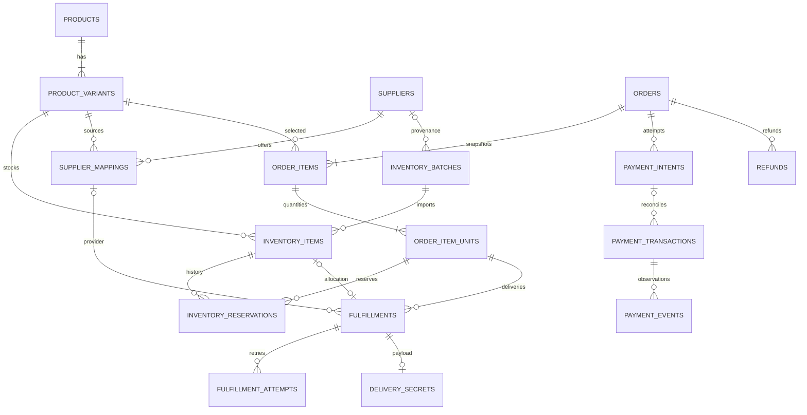

# Hubby — Database design

02/11/2026: applied forward migration20261101180959_bite_supplier_fulfillment on existing Hubby. Three private RLS tables: supplier_bindings (per-variant mapping), supplier_jobs (frozen source, one durable claim, encrypted evidence and manual lineage), supplier_audit. Only service-only invoker RPC wrappers expose operations; manual actions also validate active Owner. Existing catalog/CMS/customer data not rewritten. Checkout/link/settlement reservation guard accepts separate source obligations; delivery still requires actual encrypted inventory. More in docs/BITE_PAYOS_LIVE.md. No tests or provider transaction acceptance claimed.

Owner decision 02/11/2026: retain Supabase/Postgres as the active shop database; cancel WordPress/WooCommerce migration. Do not import Woo prototype data, reseed catalog or overwrite CMS drafts/prices. The SQLite WordPress prototype is isolated historical development data, not an operational database. Further payment/supplier schema changes belong to the existing guarded migration workflow.

OCB/Casso22/10/2026: no migration applied or schema changes authored in this batch. Future reviewed atomic receipt/settlement store must bind provider+environment+transaction ID and payload fingerprint, lock current order/reservation, persist reconciliation and exactly one ID-only outbox job in one transaction. Current CassoPaymentStore TypeScript interface is NOT a database implementation. Preserve existing private commerce tables/role policy; no service-role or public settlement bypass. See docs/OCB_CASSO_SETUP.md.

## Customer/support foundation / safe publication — 12/10/2026

Forward migration `20261012104111_commerce_customer_foundation.sql` installed: private orders→items/payments, Auth user→orders/tickets, ticket→messages, private community submissions and commerce audit. All seven new tables have RLS deny-all and revoked raw app access; seven public wrappers are invoker, private elevated functions enforce membership/ownership or Owner. Paid/refunded projections derive from verified ledger rows, not state. No checkout/settlement write API exists yet.

Support creation is atomic/idempotent with ownership/rate limits; replies use CAS and audit. Public submission writes are private, globally bounded under advisory transaction locks and idempotent. This bounds storage, not quota-denial attacks. Multi-connection hosted concurrency tests remain unrun.

Forward migration `20261012111208_cms_safe_publication.sql` adds meaningful WHERE conditions to blanket category/product/variant updates. Hosted pg-safeupdate rejected the original function; SQL diagnostics rolled back, no safety option disabled. Actual Owner-session publication then succeeded. Revision2 changed only Canva price/configured flag plus revision metadata; old history preserved and other content/products verified unchanged.

## Owner access policy — 12/10/2026

Source20261011211233_staging_owner_access_policy.sql applied remotely as20261011212354. New private.owner_access_policy(singleton true PK, password_only_issuer nullable constrained HTTPS Supabase issuer) has RLS/no app policies/no app table grants. Default null keeps MFA; operator enabled only the verified current project per Owner's explicit password-only live-admin confirmation, with null-operator password_only_authorized immutable audit. No personal Auth UUID or secrets in migration. Replaced existing private owner_status/hubby_owner definitions while retaining public invoker RPCs/ACLs. Database tests cover AAL1 Owner CMS/media access only under matching signed claims, other issuer/customer/metadata spoof denial, revoked membership and private policy-write denial. No commerce tables/data/import changed by this migration.

## Current CMS contract applied — 12/10/2026

Forward source20261011201932_current_storefront_contract.sql (remote20261011202554) adds nullable products.terms JSONB and product_variants.price_configured NOT NULL. Missing historical flag retains true; new Owner variants explicitly false until priced. Extends private validation/materialization for experience/terms/flags and all managed media slots. Existing immutable revisions/RLS/trusted Owner+AAL2/public invoker ACLs retained; no new public mutator. SQL tests cover unknown fields/null booleans/unsafe routes/duplicate IDs/inline images/missing Storage objects, publication rollback and revoked banner access.

First-content import is operator-only DML, guarded by empty revision/product/Auth state and locked CMS document, all in one transaction. It copies public content only:6 products/7 unpriced variants, author null, immutable import audit, no fake Auth actor/publication. Initial version1 is published for staging SSR, not a real sale or inventory import. Remote current CMS source is local-14; subsequent Owner edits must use normal save/publish and must not be overwritten by repeating a bootstrap. Commerce/guest-proof/feedback/payment SQL is still unimplemented, not supplied by this migration.

## Staging foundation — 12/10/2026

Owner created hubby-staging in Hubby Free / Singapore and confirmed private password rotation. Authorized staging configuration only; no live commerce or production. Verified empty application schemas, migration history, Auth users and Storage before installing existing Phase2 foundation. Do not seed the historical four-brand fixture or import local orders. Add a forward ACL migration: move privileged implementations into private, preserve public RPC signatures as SECURITY INVOKER wrappers, explicitly revoke inherited anon mutation grants and private table grants; grant only private function execution needed by wrappers/policies. Private schema remains unexposed to Data API. Retain trusted membership + AAL2 checks and immutable history. Add covering FK indexes and initplan RLS expressions without broadening row access. Verify Supabase advisors and direct anonymous REST after migration; local tests reproduce Supabase default function grants. Current CMS extensions/catalog migration and Owner/Auth UAT remain separate pending work.

Catalog v3 local extension: optional product terms(warranty/receipt/activationNote), variant priceConfigured. Unset price rejects server checkout regardless of stock. Private review submissions reuse bounded feedback storage with category=review and formatted product/rating/text; no automatic public projection. Local published revision12 preserves history/order snapshots/stock. Postgres materialization/validation migration required before publishing these extensions online. See docs/CATALOG_V3.md.

## Current local implementation boundary

Visual refresh keeps schemaVersion2 backwards-compatible through optional local-only experience JSON (stable notice/slide/review IDs). Old CMS content/revisions are not overwritten. Staging publish rejects this extension until SQL validation/materialization migration. No contact_email or guest-email token implementation added to local orders: lookup is explicitly current-session + fixture email. Support dock writes existing order-owned tickets, not Telegram messages or a new public messaging database.

Historical design-only commerce notes below refer to Supabase, not the new SQLite sandbox. Local tables hold one bounded JSON ledger, CMS workspace, hashed guest sessions and actor/minute limits. Ledger relationships: stocks → variant; orders → immutable item snapshots/reserved stock; payment observations/jobs/refunds → order; tickets → order/actor with stable message IDs; audit events retain synthetic transitions. Supplier adapters remain mock contracts, with no real purchase or supplier account persisted.

Atomic checkout, payment dedupe, delivery, replacement lineage, refund cap/retirement and CMS version conflicts are implemented locally. Limits:500 orders,1000 units,2000 observations,30 CMS revisions. This is not normalized production Postgres or proof of its RLS/concurrency. Encryption uses a public fixture key and DEMO-only payloads. See docs/LOCAL_HANDOFF.md for staging migration/key-management work; never reset retained history merely to pass tests.

Ngày: 11/10/2026. Thiết kế PostgreSQL/Supabase, chưa migration hoặc provision DB trong Phase 0. Tài liệu là contract cho Phase 2–5; không khẳng định schema/RLS đã được triển khai.

## 1. Quy ước

Local continuation decision before implementation: add a separate Workers-local SQLite Durable Object sandbox ledger for synthetic checkout/reservations/payments/outbox/refunds/support only. Atomic state updates use SQLite transactionSync and survive local preview restarts; per-browser hashed guest session scopes customer reads, demo operations restricted to loopback+local fixtures+mock flags. No remote namespace is provisioned, Supabase production design unchanged. Synthetic stock encrypted with a public DEMO-ONLY key supplied outside storage; this deliberately has no real-data confidentiality guarantee and cannot run in staging/production. Real key provisioning/imports/email guest-proof delivery remain staging gates. Browser CMS edits cannot override server baseline prices; checkout re-quotes server and rejects mismatches. This adapter is not a substitute for Postgres commerce migrations/RLS or production release.

Phase2 implementation decision (before migration): implement profiles, private trusted Owner membership, catalog/categories/variants, media metadata, immutable CMS revisions/publications, wishlist/recent views and private CMS audit only. Commerce/payment/stock/fulfillment tables remain Phase3–5. Stable fixture keys are separate from UUID database PKs. Publishing a validated storefront snapshot atomically materializes normalized catalog and moves publication pointer; old revisions immutable, rollback creates a new draft. Variant stock in this phase is explicitly demo_stock, never authoritative inventory. PGlite is a test-only Postgres engine with Auth/Storage schema stubs; it is not app persistence or proof of GoTrue/PostgREST/Storage integration. Browser-only CMS sandbox is separate from secured /admin and never grants Owner identity.

UUID PK trừ provider numeric reference/sequence riêng; `created_at`, `updated_at` timestamptz UTC; UI/report timezone Asia/Saigon. Money `bigint` nguyên VND, >=0; không float. API kiểm `Number.isSafeInteger` hoặc serialize bigint decimal strings khi lớn. `currency='VND'` CHECK. Status CHECK/enum, FK/index explicit; active data không hard-delete (archive). Order snapshots giữ được sau catalog đổi.

Public schema chỉ dữ liệu được phép đọc với RLS. `private` schema cho stock secrets, activation, payment events, job/internal ledger; không expose trực tiếp Data API. RPC privileged có execute restricted, fixed search_path; record actor/reason; không trả decrypted secret. Secret chỉ Worker giải mã khi actor có quyền. SQL migrations versioned trong `supabase/migrations` ở Phase 2, chạy synthetic DB trước; generated TypeScript từ schema khi có DB.

## 2. ER model chính

Một order chứa nhiều order item; một item qty=N có N unit rows. Mỗi unit có một fulfillment ban đầu và có thể có generation thay thế. Một stock item tối đa được bán một lần; replacement dùng stock mới. Supplier mapping nối N suppliers ↔ N variants; order unit giữ source/mapping snapshot đã chọn, không đổi nguồn sau purchase uncertain. Payment transaction có thể unmatched nên intent FK nullable; không xóa bank ledger để sửa order.

## 3. Catalog, CMS và nguồn hàng

| Entity | Fields quan trọng | Constraints / relationships |
| --- | --- | --- |
| profiles | id→auth.users, display_name, verified email reference | Không chứa password; email authoritative từ Auth |
| role_memberships | user_id, role=owner/customer, granted_by, revoked_at | Server-managed, 1 active Owner ban đầu; không user-editable metadata |
| products | id, slug, name, summary, status, content_revision_id, archived_at | slug UNIQUE; draft/published/archived |
| product_variants | id, product_id, sku, attributes JSONB, price_vnd, duration_days nullable, delivery_kind, source_policy, activation_schema_version, enabled | SKU UNIQUE; price >=0; FK product; delivery account/key/subscription/activation; source local/api/manual |
| categories / product_categories | id, slug, name, parent_id / product_id,category_id | category slug UNIQUE; join composite PK; prevent tree cycles |
| product_media | product_id, media_id, sort_order, variant_id optional | FK media; validate variant belongs product |
| media_assets | id, object_path, mime, byte_size, dimensions, alt, source/license, status, uploaded_by | UNIQUE object_path; allowlisted published assets only public |
| cms_documents | id, kind, slug, published_revision_id | slug+kind UNIQUE; revision belongs document |
| cms_revisions | id, document_id, version, schema_version, blocks JSONB, seo JSONB, author_id, created_at | UNIQUE(document_id,version); immutable |
| cms_publications | id, document_id, revision_id, starts_at, ends_at, actor_id | publish schedule/window validated; no arbitrary script |
| site_settings | key, versioned safe value, published_at | Fanpage/support/brand; no payment secrets |
| suppliers | id, name, adapter_key, enabled, capabilities JSONB, timeout_seconds, secret_reference, terms_note | Key reference only; actual key Workers secret |
| supplier_mappings | id, supplier_id, variant_id, external_sku, priority, cost_vnd, active, config JSONB | UNIQUE(supplier_id,external_sku,variant_id); config excludes credentials |
| inventory_batches | id, supplier_id nullable, source=manual/csv/api, actor_id, import_checksum, imported_at | Provenance, no raw CSV plaintext persisted in logs |
| inventory_items | id, variant_id, batch_id, status, cost_vnd, expires_at, fingerprint_hmac, key_version, nonce, ciphertext | Encrypted payload; fingerprint UNIQUE scoped variant; available/reserved/assigned/quarantined/retired |
| inventory_events | item_id, action, actor_id, order_unit_id optional, reason, created_at | Append-only; no ciphertext/plaintext in audit description |

Fingerprint HMAC (separate key) of normalized credentials/key detects duplicate imports without plain hash dictionary attack. Validate import preview and per-row errors; commit rows transactionally or documented batch strategy; same batch checksum can resume without double insert. Secret normalization must not alter actual password/key semantics.

## 4. Commerce, money and access

| Entity | Fields quan trọng | Constraints / relationships |
| --- | --- | --- |
| carts / cart_items | id, user_id nullable, anonymous_session_hash, expires_at / cart_id, variant_id, qty | Cart non-authoritative; qty positive; price derived server |
| checkout_requests | actor/session scope, idempotency_key, request_hash, order_id, status, expires_at | UNIQUE(scope,idempotency_key); different hash with same key→409 |
| orders | id, public_code, customer_id nullable, contact_email, status, subtotal_vnd, discount_vnd, total_vnd, currency, expires_at, paid_at | public_code UNIQUE (identifier not authorization); immutable totals after payment intent; total=subtotal-discount |
| order_items | id, order_id, variant_id, product_name_snapshot, sku_snapshot, variant_snapshot JSONB, unit_price_vnd, qty, discount_vnd, line_total_vnd | qty>0; snapshot of delivery terms/schema; line totals verified RPC |
| order_item_units | id, order_item_id, ordinal, source_kind, supplier_mapping_id nullable, delivery_kind_snapshot | UNIQUE(order_item_id,ordinal); N rows equals qty in checkout RPC |
| activation_inputs | unit_id, schema_version, nonce, ciphertext, key_version, state, submitted_at | private; no personal passwords by default; field allowlist/size cap |
| inventory_reservations | id, inventory_item_id, order_unit_id, state, reserved_at, expires_at, released_at | Partial UNIQUE(inventory_item_id) WHERE state='active'; partial UNIQUE(order_unit_id) same; preserve history |
| coupons | id, code_normalized, discount_type, value, max_discount_vnd, min_spend_vnd, global_limit, per_user_limit, starts_at, ends_at, enabled | UNIQUE code; fixed/percent bounded; integer rounding specified |
| coupon_scopes | coupon_id, product_id or variant_id | Only one scope column per row; FK |
| coupon_redemptions | coupon_id, order_id, identity_hash, state=held/consumed/released | UNIQUE(coupon_id,order_id); limit count locked; held counts until expiry |
| guest_access_tokens | id, order_id, email_hash, token_hash, expires_at, consumed_at | UNIQUE token hash; no plaintext token; one-time POST exchange |
| guest_order_sessions | id, session_hash, order_id, expires_at, revoked_at | Order scoped; no cross-order lookup |
| payment_intents | id, order_id, provider, provider_channel, merchant_ref, provider_link_id nullable, amount_vnd, state, request_hash, expires_at | UNIQUE(provider,channel,merchant_ref); one active intent/order via partial unique; external create/reconcile state |
| payment_transactions | id, intent_id nullable, provider, channel, provider_transaction_id, reference, direction, amount_vnd, currency, received_at, match_state | UNIQUE(provider,channel,provider_transaction_id); positive amount; ledger persists unmatched/late |
| payment_events | id, transaction_id nullable, provider, channel, provider_event_id, payload_digest, encrypted_payload optional, signature_verified, result, received_at | Provider event id UNIQUE where non-null; transaction dedupe independent; encrypted raw payload restricted |
| payment_allocations | transaction_id, intent_id, allocated_vnd | UNIQUE(transaction_id) MVP; a deposit cannot pay two orders; only exact match auto allocation |
| refunds | id, order_id, payment_transaction_id, amount_vnd, state, reason, bank_reference, initiated_by, confirmed_at | UNIQUE provider/bank refund ref when available; confirmed cumulative <= allocated paid; lock ledger |

Do not store card/bank login secrets. Email contact is PII but not inventory payload; restrict RLS/export/redact. Customer claim requires verified email and guest proof, atomic record linking with audit; registered user cannot claim by submitting someone else's email.

## 5. Fulfillment, delivery and jobs

| Entity | Fields quan trọng | Constraints / relationships |
| --- | --- | --- |
| fulfillments | id, unit_id, generation, replacement_of_id nullable, source_kind, inventory_item_id nullable, supplier_mapping_id nullable, state, idempotency_key, delivered_at | UNIQUE(unit_id,generation); UNIQUE idempotency_key; UNIQUE inventory_item_id when not null; local/API source checks |
| fulfillment_attempts | id, fulfillment_id, attempt_no, request_key, external_ref nullable, state, lease_until, started_at, finished_at, redacted_error_code | UNIQUE(fulfillment_id,attempt_no); stable provider purchase key per fulfillment; external_ref provider-scoped unique |
| delivery_secrets | fulfillment_id PK, key_version, nonce, ciphertext, content_kind, expires_at nullable | API result encrypted; local references item or immutable encrypted delivery copy, never plaintext |
| purchases | id, customer_id nullable, order_unit_id, current_fulfillment_id, revoked_at | UNIQUE order unit; guest reads through order session; product library view uses authorized projection |
| reveal_events | fulfillment_id, actor_id or guest_session_id, outcome, request_id, occurred_at | No payload; audit sensitive access |
| outbox_events | id, aggregate_id, kind, dedupe_key, payload_ids JSONB, state, next_attempt_at, lease_until, attempt_count | UNIQUE dedupe_key; committed with payment/allocation, never raw secrets |
| notification_deliveries | id, outbox_id, channel, provider_message_id, idempotency_key, state, last_error_code | UNIQUE idempotency_key; resend new notification attempt referencing same fulfillment |
| reconciliation_runs | id, provider/channel, cursor, started_at, finished_at, outcome, counts | durable progress + alert; cursor advance after persisted events |
| audit_events | id, actor, action, entity_type/id, request_id, reason, redacted_changes, timestamp | Append-only permissions; customer cannot query |

`purchases.current_fulfillment_id` must belong same unit; `replacement_of_id` same unit and lower generation. Link consistency via composite FK or restrictive RPC+DB triggers, not browser validation. Source: local requires inventory_item and no supplier purchase mapping; API requires mapping and no local item. Allocation variant must equal unit's order variant, enforced transaction/constraint trigger. Delivered generation is immutable; replacement does not reuse same item.

## 6. Customer support/marketing

`wishlists(user_id,product_id)` composite PK. `recent_views(user_id,product_id,last_viewed_at)` unique user/product, max100 proposed with cleanup; anonymous IDs only browser. `support_tickets(id,customer_id nullable,guest_session/order_id nullable,subject,category,state,created_at)` and `ticket_messages(id,ticket_id,author_id/guest_session,body,visibility,created_at)`; customer never reads internal notes. `order_notes` internal/audited. Attachments deferred or private Storage with size/mime validation and signed short links.

Recent-order marketing is a safe projection from eligible fulfilled/paid orders controlled by policy, not a raw order table view. Avoid names/order IDs/geolocation; refunded/replaced-sensitive products can be excluded. Reports use aggregates from immutable ledger/orders, not current variant price. Historical cost snapshots from stock/mapping used for margin estimates.

## 7. State machines

| Aggregate | States | Rules |
| --- | --- | --- |
| Order | pending_payment, paid, fulfilling, partially_delivered, delivered, review_required, cancelled, expired, refunded | Do not infer money from order label; paid amount is ledger; cancellation after money requires refund workflow |
| Payment intent | creating, pending, settled, expired, cancelled, create_uncertain, review_required | Provider callback alone cannot settle; exact authenticated payment allocation only |
| Transaction match | unmatched, matched, duplicate, underpaid, overpaid, late, rejected | Record and reconcile; wrong currency/account never allocates |
| Reservation | active, consumed, released | Expiry and webhook serialize on same order lock |
| Fulfillment | queued, awaiting_input, processing, delivered, uncertain, failed, review_required, superseded | uncertain not auto-retried without lookup; delivered has persisted allocation/delivery payload |
| Refund | requested, processing, uncertain, confirmed, rejected | Only confirmed money movement adjusts reports; never automatic badge-only refund |
| Outbox | pending, leased, dispatched, completed, retry, dead_letter | Lease expiry recoverable; dispatch not proof business completed |

Status changes permitted only via domain/RPC; monotonic verified facts (payment receipt, delivery) retained. Read model derives aggregate order state; cannot regress paid to unpaid on old event. Partial delivery is visible; each unit independently idempotent.

## 8. Transactions và isolation

Checkout RPC locks coupon, order idempotency scope and needed stock consistently; unique conflicts retry bounded. `FOR UPDATE SKIP LOCKED` picks eligible stock; reserve exactly quantity, rollback all if insufficient. Lock ordering documented (order → payment → coupon → stock ordered by UUID) and test deadlocks. Same stock cannot have two active reservations or two lifetime assignments. Never reserve without an order unit transaction.

Settlement RPC locks order+intent, inserts transaction `ON CONFLICT` safe, validates exact amount/account/currency/reference and active/expired policy, records allocation+outbox atomically. Unique transaction must not cause two intents settled. Coupon hold consumed once; released coupon on expiry, late payment review does not overrun quota.

Fulfillment claim RPC uses atomic lease; local delivery transaction only for verified-paid unit with valid reservation. External API call outside transaction and reconciled stable key. Queue at-least-once and outbox re-dispatch must not cause side effect twice. Monetary refund reconciliation locks original allocations and cumulative refund sum.

## 9. RLS/access matrix

| Entity | Anonymous | Customer | Guest proof | Owner AAL2 | Worker privileged |
| --- | --- | --- | --- | --- | --- |
| Published catalog/CMS/media projection | read | read | read | CRUD via server | publish |
| Profiles/wishlist/recent | none | own | none | limited support | restricted |
| Orders/items/purchases | none | own redacted | one order via server | read redacted | transact |
| Secrets/activation/stock | none | reveal via server only | reveal via server only | guarded reveal/import | encrypted read/write |
| Payments/refunds/outbox | none | order-safe status | order-safe status | guarded ops/report | settle/reconcile |
| Tickets/messages | none | own visible | own order-scoped | manage | notifications |
| Role/audit/internal notes/supplier credentials | none | none | none | guarded management | restricted |

Owner and service role cannot be taken from user metadata or frontend. Public API projections omit encrypted fields too. Index user/order scope so policies don't full scan. SQL tests as anon/customer A/customer B/guest/owner-AAL1/owner-AAL2; test direct REST and RPC invocation, not only UI hiding.

## 10. Indexes, retention, verification

Indexes: published product slug/category, variant product/enabled, inventory(variant_id,status,expires_at), reservations(state,expires_at), orders(customer_id,created_at), intent(order_id,state), transaction(provider,channel,external id), fulfillment(unit_id,generation), outbox(state,next_attempt_at), tickets(customer_id,created_at). Partial unique constraints are critical, not optional performance work.

Proposed retention awaiting Owner policy: raw encrypted webhook payload 30d; guest tokens cleanup expired daily; recent views90d; audit180d; commercial ledger/order retention to be legally verified, no automatic purge before decision; activation info removed after fulfillment + warranty/support window selected. Archive secret access on refund, do not return revealed stock to available.

Required tests Phase 2–5: migration from empty fixture DB; RLS matrix; 20 concurrent reservations for one stock; qty>1; double checkout same key; duplicate/out-of-order/missed webhook; timeout/crash after supplier accepted; expiry vs settlement; coupon concurrency; partial delivery; refund cap; replacement lineage; restore encrypted inventory with key versions. SQL execution and results absent Phase 0, tracked in IMPLEMENTATION_PLAN.

## Phase 2 local implementation (11/10/2026)

Migration `202610110001_phase2.sql` implements only profiles/private trusted role_memberships, categories/products/product_categories/variants, media_assets/private Storage bucket, CMS documents/immutable revisions/publications/private audit, wishlist/recent_views. Products/categories/variants use UUID PK plus stable catalog keys; price_vnd integer, demo_stock synthetic only, archived/disabled state on materialization. Payments/orders/reservations/fulfillment/credentials remain design-only; no real inventory table yet.

One active Owner via partial unique index, signup trigger always customer regardless user metadata. Own profile name update only; Owner has no blanket customer PII read in this phase. AAL2+trusted membership required by RPC/RLS, append-only audit/revisions, head_version CAS. Publish validates full JSON, atomically materializes catalog and published pointer; moving variant to another product fails. Seed requires explicit staging marker and empty revision history. See SQL for implemented ACLs rather than future access matrix above.

PGlite runs actual migration/RLS with synthetic auth/storage table + uid/jwt stubs; tests set database roles and claims, not cryptographic sessions. Both customer cross-access directions, anon, AAL1/AAL2, revoked Owner, raw RPC malformed payload, stale head, immutability, idempotent publish, failed atomic publish and private/published media checked. Real Supabase REST/GoTrue/Storage and multi-connection concurrency still pending. No external migration executed.

# Local storefront additions — 11/10/2026

Non-destructive SQLite additions: feedback(id,actor,key,at,payload) with UNIQUE(actor,key), review state and no required contact identity; activity(id,actor,key,variant,at,payload) with UNIQUE(actor,key), actor/time index and ephemeral15-minute retention. Feedback is private to the loopback-only operations simulator, NOT protected production Owner access; do not submit real PII. Public activity projection omits all actor/keys/order/email. Existing ledger/CMS/history unchanged; no production Postgres migration. CMS supports0..12 slide records, renders only uploaded images (legacy uploaded banner fallback), total inline images capped1.2m characters. Existing illustrative flag parses for backwards compatibility but is inert. Live tables/RLS/outbox/payment adapter remain release gates.

02/11/2026 — Applied canva_checkout_activation: private.checkout_activation stores encrypted Canva activation metadata per checkout request/order, immutable on idempotent retry with HMAC comparison. Service-only invoker wrappers delegate to guarded private reserve/admin functions; RLS deny-all and no raw client table access. Checkout reservation and activation metadata commit atomically. Owner-only CMS decrypts after server authorization; checkout contact email/ownership is unchanged.
