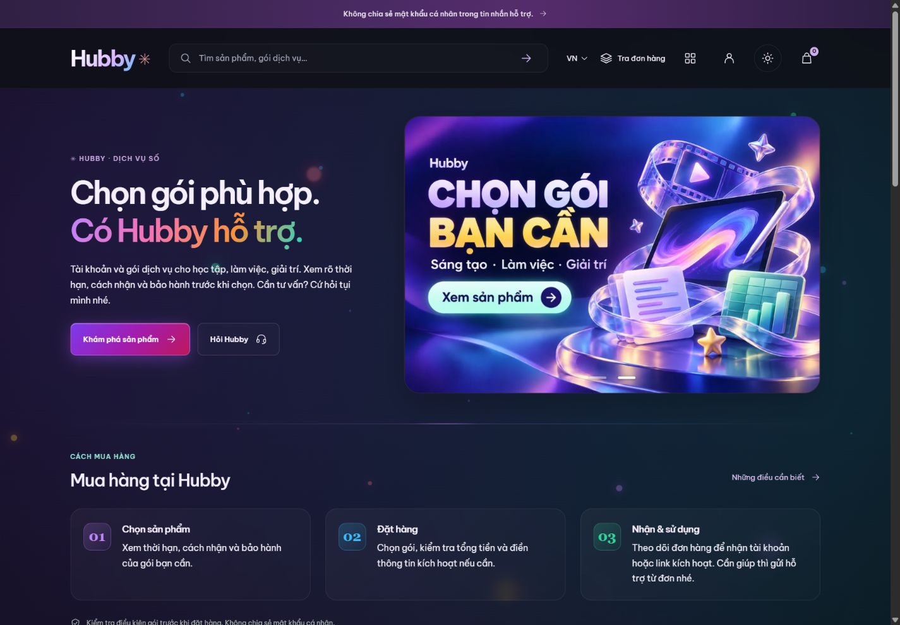

# Rà soát và kế hoạch hoàn thiện website Hubby

Cập nhật sau báo cáo trong cùng ngày 06/11: Owner yêu cầu **3 ảnh mới bằng GPT Image** theo hai mẫu công nghệ xanh/tím, thay cho đề xuất hai banner/ảnh cũ trong snapshot báo cáo. Bộ mới đã lưu/xuất bản CMS v21. Owner tiếp tục yêu cầu đưa sản phẩm trước cách mua hàng, thẻ gọn vừa phải và chuyển động nhẹ; API Telegram tạm không dùng, Owner xử lý lời mời thủ công. Kết quả mã nguồn/triển khai mới được ghi tiếp trong IMPLEMENTATION_PLAN.md. Các phát hiện phía dưới giữ bối cảnh lúc rà, không coi mọi mục còn nguyên trạng sau các lần sửa.

Ngày rà soát: 06/11/2026. Mục tiêu: chuẩn bị vận hành cho khách thật trên website hiện hữu, giữ React Router, Cloudflare Workers và Supabase; ngân sách hosting 0 đồng.

## 1. Kết luận để quyết định việc tiếp theo

Hubby đã có cửa hàng, CMS, thanh toán payOS, liên kết nguồn và luồng nhận hàng. Owner xác nhận đơn Canva mua thử đã nhận lời mời và sử dụng được. Vì vậy không còn đúng khi gọi toàn bộ hệ thống là demo hoặc khẳng định chưa có giao dịch thành công. Tuy nhiên, một đơn thành công chưa chứng minh khả năng xử lý lỗi, mua đồng thời hoặc vận hành khi Owner không mở CMS.

Nên hoàn thiện theo thứ tự: bảo đảm bản phát hành kiểm tra kiểu được; làm rõ trạng thái đơn và đường liên hệ; kiểm chứng các nhánh thanh toán và cấp hàng có rủi ro; hoàn thiện danh mục; sau đó mới tối ưu quảng bá và hiệu suất. Thay toàn bộ giao diện hay chuyển sang WordPress không giải quyết các khoảng trống này.

Ba kết quả quan trọng của lượt rà:

- `npm run typecheck` thất bại với 11 chẩn đoán tại `workers/canva-telegram.ts`. `npm run hosting:build` vẫn thành công, 318 client modules. Không được dùng kết quả build để phủ nhận lỗi TypeScript hoặc kết luận bản sẵn sàng phát hành.
- Trước chỉnh sửa, trang chủ có 6 sản phẩm nhưng 5 sản phẩm chưa có giá; banner Huber vẫn quảng cáo giảm 10% trong khi Owner xác nhận hiện không có ưu đãi. Tên gói Canva công khai ghi Pro dù Owner xác nhận bán Education.
- Có nhiều bộ kiểm thử cũ trong kho mã, nhưng các nhánh Canva activation, Bite mới và Telegram chưa có bằng chứng kiểm thử tương ứng với phiên bản hiện tại. Lượt này không chạy test suite, không tạo đơn, không thanh toán hay mua từ nguồn.

Đây là tài liệu nội bộ. Tên nguồn, mã kỹ thuật và phân tích sự cố không phải nội dung đưa nguyên văn ra shop.

## 2. Phạm vi và cách hiểu bằng chứng

Đã đọc trực tiếp website tại `https://hubby.dpdns.org`, trang chủ, Canva, bước trước thanh toán, Google AI Pro, quyền riêng tư, đổi trả và CMS; đối chiếu routes, server, migrations, tests và lịch sử triển khai. Đã xem bố cục ở viewport 1440 × 1000 và 390 × 844. Domain chính dùng phiên đang đăng nhập Owner. Cuối lượt đã mở trang chủ domain workers.dev trong trạng thái chưa đăng nhập để đối chiếu tên/bộ banner; chưa đi qua luồng mua của khách mới.

Trong lượt này chỉ xem bước thanh toán, không bấm tạo liên kết thu tiền. Không đọc hoặc xuất danh sách khách, bí mật, nội dung giao hàng hay lịch sử hội thoại Telegram. Không kiểm tra bằng thiết bị thật, không đo Lighthouse/Core Web Vitals, không đánh giá toàn bộ WCAG, không quét lỗ hổng.

Các nhãn bằng chứng dùng xuyên suốt:

- **Đã quan sát:** nội dung hoặc trạng thái thấy trực tiếp trên web ngày rà soát.
- **Đã đối chiếu mã:** hành vi có căn cứ trong nguồn hiện tại; chưa đồng nghĩa đang chạy đúng trên bản công khai.
- **Owner xác nhận:** thông tin do Owner cung cấp trong lượt này, chưa được tái hiện độc lập.
- **Chưa xác minh:** cần quan sát hoặc kiểm thử; không được tự đổi nhãn thành lỗi đã xảy ra.
- **Lịch sử:** bằng chứng của lần trước, chỉ dùng khi nêu rõ thời điểm và giới hạn.

Không chấm điểm tổng thể vì chưa đo đủ hiệu năng, khả năng tiếp cận, bảo mật và các luồng người mua. Một điểm số lúc này sẽ tạo cảm giác chắc chắn không có căn cứ.

## 3. Quyết định và dữ kiện mới của Owner

- Website cần nhận khách thật, không tiếp tục định vị là demo.
- Gói bán là **Canva Education 3 năm**, giá **49.000đ**, bảo hành **1 năm**. Cách nhận hiện là lời mời qua email.
- Owner tự xử lý nguồn hàng và điều kiện phía nguồn; không yêu cầu cung cấp thêm chi tiết nội bộ trong báo cáo.
- Thời gian xử lý Owner chốt là tối đa **15 phút**; nếu chưa nhận thì khách liên hệ trực tiếp. Đây là mục tiêu dịch vụ cần kiểm chứng khả năng đáp ứng, chưa phải số liệu đo được.
- Fanpage: `https://www.facebook.com/profile.php?id=61595097339588`.
- Email hỗ trợ: `admin@hubby.dpdns.org`. Địa chỉ do Owner cung cấp; chưa thử gửi/nhận thư hoặc xác minh cấu hình mail.
- Không có ưu đãi. Bỏ chiến dịch Huber, mã HUBBYxHUBER và lời quảng cáo giảm 10% khỏi nội dung đang trình bày cho khách.
- Owner xác nhận đơn Canva 49.000đ trước đây đã nhận lời mời và dùng được. Không dùng xác nhận này để suy ra mọi nhánh tự động, mọi nguồn và mọi đơn đều đã nghiệm thu.
- Không bổ sung chính sách đổi/hoàn tiền hoặc điều kiện nguồn hàng ngoài ý muốn của Owner. Giữ đúng các điều khoản đã công bố; không tự đặt thêm cam kết.

Hai mốc 15 phút khác nhau cần tách rõ: thời hạn thanh toán/giữ đơn và thời gian xử lý sau thanh toán. Không dùng câu giữ đơn 15 phút để thay lời giải thích khi nào khách nhận được lời mời.

## 4. Những phần nên giữ

- Giữ thiết kế hiện tại: bảng màu tím, mint, peach; giao diện tối/sáng; intro trái và banner phải; thẻ sản phẩm gọn. Không có bằng chứng phải thay kiến trúc hoặc thiết kế lại toàn bộ.
- Giữ server tính lại giá và từ chối gói chưa niêm yết. “Chưa có giá” trung thực hơn tự đặt giá mẫu hoặc nhận tiền cho gói chưa chuẩn bị.
- Giữ phân biệt email tài khoản Hubby với email Canva nhận lời mời. Trang trước thanh toán đã giải thích có thể dùng hai email khác nhau và không yêu cầu mật khẩu/OTP.
- Giữ tra đơn, hỗ trợ gắn đơn và quyền nhận hàng ở server; không mở quyền chỉ vì khách biết email hoặc đoán mã.
- Giữ lưu nháp, xuất bản riêng, lịch sử CMS và cơ chế chống ghi đè. Không tự xuất bản toàn bộ bản nháp cũ chỉ để sửa một nhãn.
- Giữ chữ ký webhook, bằng chứng thanh toán bền vững, mã hóa dữ liệu giao và trạng thái cần đối soát. Một giao dịch không rõ kết quả không được mua lại bằng danh tính mới.
- Giữ hai domain và ranh giới cookie từng host. Có domain dự phòng hữu ích; không giả định đăng nhập/guest proof tự đi theo khi đổi domain.

## 5. Các phát hiện cần xử lý

Mức P0 là chặn phát hành hoặc nguy cơ tiền/hàng bị xử lý sai; P1 ảnh hưởng trực tiếp mua và hỗ trợ; P2 là cải thiện tiếp theo. Mức này dùng để xếp việc, không khẳng định mọi rủi ro đã xảy ra.

### F01 P0 Bản nguồn hiện tại chưa qua TypeScript

**Bằng chứng:** lệnh `npm run typecheck` exit 1, 11 chẩn đoán trong `workers/canva-telegram.ts`: import `LogLevel` không tồn tại; truyền native bigint vào kiểu BigInteger ở ba vị trí; `Api.KeyboardButtonCallback` không tồn tại ở ba vị trí; button có thể undefined và chưa có thuộc tính data; update randomId có thể undefined; chưa thu hẹp kiểu update để lấy id. Các dòng liên quan: 3, 51, 59, 61, 62, 63, 76, 81.

**Ảnh hưởng:** không thể tin rằng phần Telegram mới tương thích thư viện đang khóa phiên bản. Build chuyển đổi mã thành công không kiểm tra đầy đủ những lỗi này. Chưa kết luận bản public đang lỗi giống local vì chưa chứng minh hai bản cùng artifact.

**Việc cần làm:** sửa theo API của phiên bản `teleproto` thực tế, thu hẹp kiểu rõ ràng, kiểm tra export và kiểu ID; không dùng ép kiểu toàn cục hoặc bỏ TypeScript để lách. Sau đó chạy lại typecheck và build. Khi được cho phép kiểm thử, thêm tình huống gửi thành công, lỗi và gián đoạn.

**Đạt khi:** typecheck exit 0; build exit 0; có bằng chứng hành vi với cùng artifact sẽ triển khai.

### F02 P0 Cần chứng minh khả năng khôi phục hàng đợi Telegram

**Bằng chứng mã:** `workers/canva-telegram.ts:33,39,85` đặt khóa `blocked` trước giải mã/kết nối và chỉ xóa sau gửi, lưu DB thành công. Nhánh catch giữ khóa để tránh gửi nhầm/gửi lại. Migration Telegram cũng dừng claim khi có job sending/attention. Màn hình quản trị hiện chỉ có liên kết đơn và xử lý hàng chờ; chưa thấy thao tác khôi phục khóa có giám sát trong các file đã đọc.

**Đánh giá:** cơ chế dừng là chủ ý bảo toàn dữ liệu, không nên đơn giản xóa khóa tự động. Nhưng nếu không có lối khôi phục có chứng cứ, một lỗi trước khi gửi cũng có thể làm các đơn sau chờ vô hạn. Đây là rủi ro từ mã, chưa tái hiện trên runtime.

**Việc cần làm:** phân biệt chưa gửi, đã gửi nhưng chưa xác nhận và đã xác nhận. Ghi bằng chứng lần thử; Owner có quy trình đối chiếu tin nhắn/đơn rồi mới giải phóng đúng khóa. Khôi phục phải chống hai người thao tác và giữ randomId cũ khi cần xác minh. Không mở nút “gửi lại” vô điều kiện.

**Đạt khi:** mô phỏng mất kết nối trước/sau SendMessage và lỗi lưu DB đều không gửi nhầm email, không gửi lặp và không chặn vĩnh viễn các đơn hợp lệ.

### F03 P1 Tên Canva cần thống nhất ở mọi nơi

**Quan sát trước chỉnh:** thẻ sản phẩm, h1 và mô tả ghi Canva Pro 3 Năm. Owner xác nhận Education. CMS có giá 49.000đ và bảo hành 1 năm.

**Việc đã thực hiện:** sửa đúng tên sản phẩm và tiêu đề gói trong mô tả qua CMS. Không thay slug, ID biến thể, giá, thời hạn, bảo hành hay liên kết nguồn.

**Việc còn lại:** rà email/receipt, giỏ đã lưu và snapshot đơn. Không sửa tên/điều khoản của đơn lịch sử nếu đó là snapshot lúc khách mua. Mã chọn ảnh dự phòng vẫn đối chiếu đúng tên `Canva Edu`; cần cho phép tên mới một cách có giới hạn, không gán hình Canva cho sản phẩm bất kỳ.

**Lưu ý nội bộ:** tài liệu cũ có mô tả khác nhau về mã nguồn #550; Owner tự xử lý nguồn. Báo cáo không tự đổi mapping hoặc khẳng định hai loại gói tương đương chỉ từ tên. Chỉ cần đầu ra giao khách đúng gói đã bán.

### F04 P1 Banner quảng cáo ưu đãi không còn áp dụng

**Quan sát:** slide 2 có HUBBY × HUBER, giảm 10% và mã HUBBYxHUBER. Mã thanh toán thật còn từ chối coupon; `startPayosCheckout` báo mã ưu đãi chưa bật. Owner xác nhận không có ưu đãi.

**Việc cần làm:** bỏ ảnh/alt/link chiến dịch khỏi bộ đang hiển thị. Không cần xóa tài sản lịch sử hoặc sửa đơn cũ. Dùng nội dung giới thiệu và danh mục hiện có; bộ ảnh mới dùng prompt ở phần 9. Không lấy một hình giảm giá khác thay cho Huber.

**Đạt khi:** mọi slide đang hiển thị không còn Huber, HUBBYxHUBER hay 10%; cả CMS preview và public khớp lựa chọn; không hiển thị khung trống.

### F05 P1 Khách chưa có đường liên hệ trực tiếp rõ ràng

**Quan sát:** trang chủ hướng sang tra đơn, FAQ và góp ý; chưa thấy Fanpage/email trong các vùng hỗ trợ đã đọc. Source SupportDock không hiện khi fanpageUrl trống.

**Ảnh hưởng:** khách đã trả tiền, quá 15 phút hoặc mất phiên tra đơn có thể bị vòng quanh website; góp ý chung không thay cho hỗ trợ khẩn của đơn đã mua.

**Đề xuất:** hiện Fanpage và email Owner cung cấp tại khối hỗ trợ, footer, trang tra đơn khi không tìm thấy, trạng thái chờ kích hoạt và trang lỗi. CTA “Nhắn Hubby trên Facebook”, “Gửi email hỗ trợ”; nhắc gửi mã đơn, không gửi mật khẩu/OTP. Email cần `mailto:` và có thể sao chép. Không hứa 24/7 hoặc phản hồi ngay.

**Đạt khi:** khách chưa đăng nhập vẫn tìm được kênh trực tiếp trong một bước; link mở đúng Fanpage; việc gửi thư thật được Owner xác nhận riêng.

### F06 P1 Trạng thái đã trả tiền chưa đủ để khách biết khi nào dùng được

**Bằng chứng:** checkout nêu sẽ xử lý lời mời sau thanh toán; luồng Telegram phân biệt “đã gửi email qua Telegram” với “lời mời Canva hoàn tất”. Owner chốt mốc 15 phút nhưng chưa có số liệu đo khả năng đáp ứng.

**Đề xuất:** trang đơn thể hiện rõ Chờ thanh toán → Đã nhận thanh toán → Đang xử lý lời mời → Hoàn tất. “Đã gửi email cho nguồn” là trạng thái nội bộ, không gọi là đã giao. Hiện mốc xử lý từ thời điểm xác minh thanh toán, thông báo quá hạn và nút liên hệ. Không dựng đồng hồ giả hoặc tự chuyển sang hoàn tất khi đủ 15 phút.

**Nội dung đề xuất sau khi xác minh vận hành:** “Hubby xử lý lời mời trong tối đa 15 phút sau khi xác nhận thanh toán. Nếu chưa nhận được, hãy liên hệ Hubby và gửi mã đơn.”

### F07 P1 Danh mục chưa phản ánh rõ phạm vi bán thật

**Quan sát:** 6 sản phẩm, 7 gói; chỉ Canva có giá, 5 sản phẩm còn lại chưa có giá. Gói chưa giá không có nút mua hoạt động trên trang đã xem.

**Đề xuất:** trước mắt trình bày Canva là sản phẩm đang bán; các sản phẩm khác chuyển nhóm “Đang cập nhật” hoặc giữ xem thông tin với CTA hỏi đúng kênh. Không giấu giá bằng “liên hệ” nếu khách không có đường liên hệ hoạt động. Không cần chốt đủ 7 gói mới vận hành một SKU đã chuẩn bị.

**Đạt khi:** mỗi gói được phép mua có giá, cách nhận, nguồn đủ điều kiện và quy tắc thời hạn; gói chưa chuẩn bị không tạo liên kết thu tiền.

### F08 P1 Lời hướng dẫn tra đơn chưa nhất quán giữa các màn hình

**Bằng chứng mã:** checkout guest giải thích cần cùng trình duyệt; trang kết quả lại nói có thể kiểm tra bằng mã và email. Action tra đơn còn yêu cầu guest proof; claim chéo thiết bị phụ thuộc cờ `GUEST_CLAIM_READY`.

**Đề xuất:** cùng một câu hướng dẫn ở checkout, return page và tra đơn. Giải thích cookie/thiết bị bằng ngôn ngữ dễ hiểu; cho người mất phiên liên hệ trực tiếp. Không nới quyền tra đơn thành mã+email đơn thuần để làm UI có vẻ thuận tiện.

**Chưa xác minh:** giá trị cờ claim trên hosted, migration hiện tại, hành vi khách mới, thiết bị khác và trình duyệt trong ứng dụng ngân hàng.

### F09 P1 Giới hạn một lời mời Canva chỉ được phát hiện quá muộn

**Bằng chứng mã:** trang sản phẩm cho tăng số lượng đến min(9, stock), còn checkout chặn `canva-36` khi số lượng khác 1. UI đã có lỗi và nút thanh toán bị khóa nhưng người mua vẫn đi qua bước chọn không hợp lệ.

**Đề xuất:** ngay trang Canva giới hạn một lời mời/đơn, gợi ý tạo đơn riêng cho email khác. Cart cũng dùng cùng quy tắc. Giữ guard server hiện có; không chỉ sửa nút tăng số lượng.

**Đạt khi:** cả Mua ngay, Thêm giỏ, giỏ cũ và URL sửa tay đều nhất quán; không tạo đơn thanh toán cho số lượng không hợp lệ.

### F10 P1 Cần bằng chứng bản thực tế khớp bản đã triển khai

**Lịch sử:** IMPLEMENTATION_PLAN từng ghi deploy thành công nhưng public vẫn phục vụ manifest cũ. **Mã hiện tại:** X-Hubby-Release là chuỗi cố định từ 02/11, nên nhiều lần build có thể cùng header.

**Đề xuất:** đóng dấu release ID từ commit/build vào artifact, lưu version triển khai, manifest và thời gian; kiểm lại cả domain chính và dự phòng sau deploy. Rollback phải biết cả artifact lẫn schema tương thích. Không cần công khai chi tiết kỹ thuật cho khách.

**Đạt khi:** build ID/mã tài sản và thay đổi nhìn thấy khớp nhau trên hai domain; không chỉ dựa exit 0 của Wrangler.

### F11 P1 Công cụ kiểm tra artifact chưa theo kịp kiến trúc Telegram

**Bằng chứng mã:** hosting-preflight.ts coi mọi Durable Object binding hoặc migration là dấu local simulator và luôn trả productionReady=false. wrangler.hosted.jsonc nay khai báo CanvaTelegram thật với SQLite migration. Đây là mâu thuẫn xác định được khi đọc mã, không phải kết quả đã chạy preflight trong lượt này.

**Đề xuất:** allowlist đúng binding/class/migration đã được duyệt, vẫn từ chối LocalShop và binding ngoài phạm vi. Đổi báo cáo để tách hợp lệ artifact với nghiệm thu vận hành. Không xóa guard toàn bộ để được báo xanh.

### F12 P1 Thời gian hàng đợi cần phù hợp mốc 15 phút

**Bằng chứng mã:** cron 5 phút; mỗi maintenance pass gọi một lượt xử lý Bite và tối đa 3 lần giao kho. Telegram xử lý một job mỗi lần wake. Đây không phải phép đo thông lượng hoàn chỉnh vì còn webhook/request kích hoạt và công việc từng job khác nhau.

**Rủi ro:** khi có hàng chờ, lỗi nguồn hoặc phiên Telegram bị khóa, thời gian nhận có thể vượt 15 phút. Không thể lấy chu kỳ cron 5 phút để chứng minh cam kết 15 phút luôn đạt.

**Đề xuất:** đo từ payment verified đến invitation ready; đếm job lâu nhất, tuổi hàng chờ và độ trễ từng bước; ngừng nhận thêm khi không còn năng lực xử lý. Chốt quy trình báo quá hạn cho Owner mà không tự mua lại.

### F13 P1 Cảnh báo vận hành hiện phụ thuộc việc mở CMS

**Quan sát:** CMS hiển thị 347 nhóm thay đổi nguồn chưa xem tại thời điểm đọc, và giải thích thông báo máy tính hoạt động khi trang quản trị còn mở. Đó là nhóm thay đổi catalog, không phải 347 đơn lỗi.

**Đề xuất:** tách cảnh báo ảnh hưởng đơn đã trả tiền khỏi thay đổi giá/tồn thông thường; ưu tiên quá 15 phút, lỗi xác minh tiền, không giao được và ví nguồn thiếu. Chưa có bằng chứng thông báo ngoài trình duyệt cho mọi loại sự cố. Owner cần có cách nhận cảnh báo phù hợp khi đóng tab, dùng kênh đã có và trong ngân sách.

### F14 P2 Nút FAQ dẫn sai vị trí

**Quan sát và mã:** `app/routes/home.tsx:354` đặt link “Câu hỏi thường gặp” tới `/ho-tro`; `legacy-section.ts` chuyển `/ho-tro` thành `/#ho-tro`. Người dùng quay lại khối hỗ trợ thay vì `/#faq`.

**Đề xuất:** đổi riêng link FAQ sang `/#faq`; giữ các link hỗ trợ có chủ đích. Đạt khi bấm từ desktop/mobile đều tới phần câu hỏi và không bị sticky header che tiêu đề.

### F15 P2 Chính sách đang quá chung để tự phục vụ

**Quan sát:** trang đổi trả/bảo hành chỉ có một đoạn chuyển trách nhiệm xem từng gói; trang quyền riêng tư là một đoạn chung. Chưa thấy đường email trực tiếp trong nội dung đã xem.

**Đề xuất trong phạm vi Owner chọn:** bố cục lại theo câu hỏi thực tế, dẫn tới thông tin bảo hành hiện có của gói, chỉ cách gửi yêu cầu và nhắc không gửi bí mật. Thêm kênh liên hệ đã cung cấp. Không tự tạo điều khoản đổi/hoàn, thời gian phản hồi hay ngoại lệ bảo hành. Việc rà pháp lý đầy đủ là công việc riêng, chưa thực hiện trong lượt này.

### F16 P2 SEO đang bị khóa toàn site

**Bằng chứng mã:** `app/root.tsx:69` luôn xuất `noindex, nofollow`. Chưa thấy triển khai canonical, sitemap, Open Graph hoặc Product structured data trong phạm vi source được tìm.

**Đề xuất:** khi trang bán và luồng khách sẵn sàng, mở index cho trang chủ/sản phẩm/chính sách phù hợp; vẫn chặn index admin, auth, checkout và trang đơn. Chọn domain chính cho canonical, giữ domain dự phòng. Chỉ khai giá/tồn/schema khi đúng dữ liệu thật; không thêm rating giả.

**Giới hạn:** chưa xác minh Search Console, robots.txt thực tế, lịch sử index hay lỗi crawl trên dịch vụ tìm kiếm.

### F17 P2 Cần đo hiệu năng trước khi tối ưu mạnh

**Bằng chứng:** build tạo CSS khoảng 151,38 kB trước gzip, root nạp cả CSS storefront và admin. Loader chờ identity, provider settings và nội dung; provider settings có timeout 5 giây. Response handler đặt private/no-store cho mọi response ứng dụng. Đây là những ứng viên cần đo, chưa phải chứng cứ web chậm ngoài thực tế.

**Đề xuất:** đo tải trang khách mới trên mạng di động, TTFB/LCP/INP/CLS và waterfall; sau đó tách CSS admin, giảm đoạn dùng chung và cache có ranh giới. Không cache toàn bộ loader có trạng thái Owner, CSRF hoặc đơn hàng. Ảnh và nội dung công khai có thể tối ưu riêng.

### F18 P2 Ảnh banner và alt ảnh cần rà chất lượng

**Quan sát:** ở viewport desktop 1440, ảnh students-768 được tải có natural size 600 × 400 dù srcset khai 768w; rendered khoảng 664 × 442. Sai số kích thước khai báo khiến chọn ảnh chưa chính xác và có thể thiếu nét. Các ảnh sản phẩm đều tải được tại lúc đọc nhưng alt là canva, office, doulingo, gemini; tên doulingo viết sai.

**Đề xuất:** đo kích thước thật của tất cả biến thể rồi đặt srcset đúng; xuất đủ kích thước từ ảnh gốc. Alt mô tả chức năng, không nhồi từ khóa. Ảnh trang trí có thể alt rỗng nếu tên sản phẩm đã đầy đủ cạnh bên. Không thay ảnh Owner bằng biểu tượng mặc định chỉ vì đổi tên.

### F19 P2 Giao diện điện thoại cần rút ngắn đường tới sản phẩm

**Quan sát:** tại 390 × 844, đầu section sản phẩm cách đầu trang khoảng 1444 CSS px trong lần đo, do intro, banner và các bước mua đứng trước. Không có overflow ngang ở hai viewport đã đọc. Kết quả này không đại diện mọi trang/mức zoom.

**Đề xuất:** giữ phong cách và cấu trúc nhưng giảm chiều cao intro trên phone, đưa CTA tới catalog rõ hơn hoặc rút gọn phần cách mua. Khi đang bán một SKU, tập trung ưu tiên SKU đó có thể hiệu quả hơn tăng số banner. Header icon chính đo được 44 × 44; nút submit tìm kiếm 36 × 36, nên rà cả khoảng cách, không kết luận vi phạm WCAG chỉ từ chuẩn đích chạm 44.

### F20 P2 Cần làm sạch tài liệu và bộ kiểm thử lịch sử

**Bằng chứng:** nhiều tài liệu đan xen Phase 0, checkout mock, payOS, Casso, WordPress đã hủy và các mốc không test. Có 46 file `tests/*.test.ts`; cấu hình Vitest là Node, không có Worker bindings/provider thật. Một số test checkout dùng variant `canva-edu-3y`, trong khi nhánh activation thật nhận diện `canva-36`.

**Đề xuất:** một bảng trạng thái hiện hành có ngày và link bằng chứng; tài liệu cũ giữ nhưng gắn historical. Rà coverage theo hành vi mới, không theo số file hoặc tổng test cũ. Đặc biệt test đang mock startPayosCheckout không chứng minh được validation activation trong hàm thật.

## 6. Ma trận chức năng và mức xác minh

### Những gì đã có bằng chứng trong lượt này

- Trang chủ, trang Canva, bước trước thanh toán, Google AI Pro và hai trang chính sách mở được trên domain chính.
- CMS dùng phiên Owner thực, hiển thị 6 sản phẩm/7 gói; bản 18 ban đầu đã xuất bản, không có bản nháp chờ. Đã dùng quy trình lưu nháp/xuất bản để sửa tên Canva.
- Layout trang chủ tại 390 và 1440 CSS px không có overflow ngang trong lần đo; ảnh sản phẩm tải được.
- TypeScript thất bại; build thành công. Đây là kiểm tra kiểu/đóng gói, không gọi là kiểm thử nghiệp vụ.
- Owner xác nhận đơn mua trước đã dùng được. Không tự tái hiện giao dịch hoặc xác minh toàn bộ hệ thống từ một đơn.

### Những gì chưa được kiểm thử lại trên bản hiện tại

- Khách chưa đăng nhập, thành viên thường, đăng ký/xác nhận email, khôi phục mật khẩu và OAuth.
- Tìm kiếm/gợi ý, sắp xếp/category khi kết hợp, giỏ cũ, yêu thích và xem gần đây qua các phiên.
- Tạo link, quay về từ ngân hàng, khách bỏ trang giữa chừng và mở lại thanh toán.
- Webhook đúng/sai/trùng/mất/đến muộn; khoản thiếu/thừa/sai tham chiếu; đồng thời webhook và đối soát.
- Reservation cuối cùng, hết hạn giữ hàng, stale stock, giá nguồn đổi, lỗi ví, supplier pending/file và timeout sau POST.
- Nhận hàng, quyền sở hữu, guest mất cookie/đổi thiết bị, claim và hai domain.
- Activation đúng email, khác email Hubby, số lượng sai, Telegram gửi nhầm/gửi lặp/khóa hội thoại.
- Đơn quá 15 phút, thông báo cho Owner khi đóng CMS, ticket thật, mail hỗ trợ.
- Publish conflict từ hai tab, upload lỗi, restore như bản nháp, rollback runtime/schema và khôi phục khóa mã hóa.
- Hiệu năng, tải đồng thời, thiết bị thật, keyboard/reduced motion/zoom và khả năng tiếp cận đầy đủ.

Không ghi “chưa từng kiểm thử” cho toàn bộ các mục này: kho mã có kiểm thử lịch sử. Kết luận chính xác là chưa có bằng chứng nghiệm thu lại các hành vi tương ứng trên phiên bản hiện hành.

## 7. Danh sách kiểm thử để bàn giao

Các trường hợp sau là kế hoạch, **chưa chạy trong lượt này**. Dùng dữ liệu tổng hợp cho test tự động; các bước liên quan tiền thật chỉ thực hiện khi Owner cho phép riêng, với phạm vi và số tiền cụ thể. Không cần mua thêm để chứng minh giao diện.

### Nhóm A Hiển thị và chọn gói

- A01: khách mới mở home/Canva ở 390, 768, 1024, 1440 px; đúng tên Edu, không Huber/giảm giá, không overflow. Lưu ảnh và URL.
- A02: search Canva, từ có dấu/không dấu, không có kết quả; category kết hợp search/sort và nút đặt lại giữ logic. Không cần ghi dữ liệu server.
- A03: gói chưa có giá không mua được qua UI, URL trực tiếp và POST sửa tay. Không phát sinh link hay giữ kho.
- A04: Canva số lượng 1; giỏ cũ quantity 2; URL quantity 2; form sửa tay. Server từ chối và UI giúp quay lại đúng nơi, không tạo link sai.
- A05: ảnh lỗi và ảnh tải chậm; fallback không đổi sản phẩm, layout không nhảy lớn; alt có nghĩa.

### Nhóm B Tài khoản và quyền đơn

- B01: đăng ký, xác nhận email, đăng nhập/logout với tài khoản tổng hợp; customer không thấy/quản trị được Owner.
- B02: quên/reset mật khẩu qua đúng domain callback; thông báo lỗi không nói đã gửi khi provider thất bại. Owner tự xử lý credential.
- B03: signed-in email chưa xác minh không checkout; sửa email ẩn không chuyển ownership. Email kích hoạt khác email Hubby vẫn được gắn đúng đơn.
- B04: guest cùng trình duyệt nhận đúng đơn; mã/email đúng nhưng cookie khác không xem dữ liệu giao.
- B05: guest mất cookie/đổi thiết bị: có hướng dẫn liên hệ, không lộ đơn. Nếu bật claim, xác minh email hiện tại và không chuyển đơn đã có chủ.
- B06: cùng người mở hai domain, không giả định chia sẻ session; link return/callback chọn đúng host và không mất quyền nhận hàng.

### Nhóm C Thanh toán

- C01: double-click và gửi lại cùng request key: chỉ một đơn/link hợp lệ, giữ một lần, không trừ nguồn hai lần.
- C02: timeout trước/sau create-link và lỗi lưu link: về đúng trạng thái uncertain; đối soát không tự tạo link mới mù quáng.
- C03: webhook sai chữ ký/số tiền/tài khoản/currency/link/reference: không paid và không khởi động cấp hàng.
- C04: webhook hợp lệ phát lại hoặc đồng thời: một receipt được commit, một ý định giao, không lặp tiền/hàng.
- C05: trang return bị sửa query PAID, đóng trang hoặc cancel: không tự đánh dấu paid; khách có đường tra đơn.
- C06: đến hạn, trả muộn, thiếu/thừa tiền: lưu bằng chứng và cần đối soát theo quy tắc; không giao tự động khi chưa đủ điều kiện.
- C07: mất callback nhưng provider xác nhận đã trả: cơ chế đối soát phục hồi đúng đơn và tài khoản, không tin ảnh chuyển khoản.

### Nhóm D Nguồn và nhận hàng

- D01: còn 1 hàng và 2 khách đồng thời: chỉ đơn đủ điều kiện được nhận tiền/giữ hàng theo thiết kế; không âm kho hoặc cấp trùng.
- D02: nguồn hết hàng, giá đổi, snapshot quá hạn và sync lỗi: ngừng nhận đơn mới đúng gói; đơn cũ còn nghĩa vụ xử lý.
- D03: Bite POST timeout sau khi đã trừ: giữ idempotency key, tra bằng order ID/bằng chứng; không mua lại dưới danh tính mới.
- D04: nguồn pending/processing sau đó delivered: không thông báo đã nhận hàng sớm; poll cập nhật đúng gói/số lượng/đơn.
- D05: nguồn trả file, response khác schema hoặc lỗi sau trừ: giữ bằng chứng riêng và chuyển xử lý; không đưa đường dẫn private ra public.
- D06: mở nội dung giao với customer khác, mã đoán và cache trung gian: đều bị chặn; chủ đúng xem được, no-store và không lộ qua log.

### Nhóm E Canva và Telegram

- E01: email Canva rỗng/sai/quá dài, quantity sai: bị chặn trước gọi provider; trim/chuẩn hóa không làm email của đơn khác bị thay.
- E02: hai đơn dùng hai email: từng email gắn đúng lời mời/đơn nguồn; trạng thái sent không bị coi là khách đã dùng được.
- E03: bot không đúng, không tìm thấy order hoặc hội thoại đổi sang order khác: dừng, không gửi nhầm; có lối xử lý Owner.
- E04: lỗi trước gửi, mất mạng sau gửi, thiếu messageId, lỗi lưu DB: không gửi lặp và khôi phục hàng chờ theo chứng cứ.
- E05: webhook, cron và nút Owner chạy đồng thời: chỉ một claim/gửi cho cùng job; không khóa toàn hàng đợi vô hạn.
- E06: nguồn xử lý chậm/quá 15 phút: hiển thị đúng chờ, có Fanpage/email và cảnh báo Owner; không chuyển thành giao xong theo thời gian.

### Nhóm F CMS và vận hành

- F01: hai tab cùng sửa: save/publish conflict không mất dữ liệu; chỉ bản đã lưu được xuất bản; restore tạo bản nháp mới.
- F02: sửa banner/name: public đúng, draft cũ và giá/điều khoản khác không bị ghi đè; banner rỗng có chủ đích được tôn trọng.
- F03: ticket của khách đúng đơn gửi được; khách khác không đọc được; góp ý không bị nhầm thành ticket khẩn.
- F04: mất cron/DB/Telegram: Owner nhận cảnh báo có ích; biết phần nào vẫn hoạt động và cách ngừng nhận đơn mới an toàn.
- F05: backup/restore và khóa mã hóa: khôi phục được dữ liệu tổng hợp và đọc đúng hàng; không đưa key/backup lên chat hoặc Git.
- F06: deploy/rollback: release ID trên cả domain khớp artifact; migration tương thích; rollback không xóa receipt/đơn đã trả.
- F07: bàn phím, focus modal, Escape, zoom 200%, reduced-motion, dark/light và phone thật. Không dùng một screenshot để kết luận đạt WCAG.

Mỗi kết quả nên lưu: mã ca, thời gian Asia/Saigon, build/version, môi trường, dữ liệu tổng hợp, mong đợi, thực tế, pass/fail và bằng chứng đã che dữ liệu. Không lưu password, key, OTP hoặc nội dung giao thật trong báo cáo.

## 8. Kế hoạch hoàn thiện theo đợt

### Đợt 1 Sửa những điểm gây hiểu nhầm và bảo đảm phát hành được

Phạm vi: F01, F03, F04, F05, F06, F09, F10, F11, F14. Giữ thiết kế, giá và dữ liệu. Không mở thêm nhà cung cấp hoặc SKU chưa chuẩn bị.

Đầu ra: tên Canva thống nhất; không ưu đãi Huber; link liên hệ thật; FAQ tới đúng mục; mỗi đơn Canva một lời mời; kiểu TypeScript và build đạt; dấu release và preflight phản ánh kiến trúc thực tế. Công bố rõ phần nào chỉ sửa nội dung, phần nào đã kiểm hành vi.

### Đợt 2 Khép kín luồng mua và xử lý khi lỗi

Phạm vi: F02, F08, F12, F13; thực hiện các ca B/C/D/E quan trọng khi được cho phép. Không đánh đồng đăng ký webhook thành công với một giao dịch được xử lý đầu cuối.

Đầu ra: một luồng khách mới hoàn chỉnh, một luồng đã trả tiền nhưng chờ cấp hàng và các lối phục hồi có giám sát. Có số liệu thực tế về mốc 15 phút trước khi quảng bá “tự động” rộng rãi. Mở bán theo năng lực xử lý; có thể tập trung Canva trước, chưa cần đủ cả danh mục.

### Đợt 3 Hoàn thiện nội dung và vận hành hằng ngày

Phạm vi: F07, F15, F20; tổ chức nội dung CMS, các gói còn thiếu, tài liệu hiện hành, cảnh báo và quy trình xử lý khách không tra được đơn. Các điều khoản thương mại do Owner quyết định, Codex không tự đặt.

### Đợt 4 Tối ưu tìm kiếm và trải nghiệm

Phạm vi: F16, F17, F18, F19 và ca F07 kiểm tra khả năng tiếp cận ở phần 7. Chỉ mở index trang công khai khi sẵn sàng; đo rồi tối ưu. Không mua hosting, domain hay dịch vụ trả phí tự động để giải quyết thiếu bằng chứng.

## 9. Định hướng và prompt thay banner

Không dùng Huber, sinh viên HUB, mã giảm giá hoặc tỷ lệ ưu đãi. Giữ Modern Gradient hợp giao diện hiện tại, giới hạn số ảnh có mục đích. Trước mắt hai banner hiện có về thương hiệu và danh mục đủ dùng; không cần thêm slide chỉ để đủ số lượng.

Khi tạo bộ ảnh mới, đề xuất hai chủ đề chính dưới đây. Banner thứ ba về hỗ trợ chỉ thêm nếu có ích sau khi hai banner chính đã tốt. Mỗi banner cần một ý chính; không liệt kê sáu tên ứng dụng hoặc thu nhỏ toàn bộ trang sản phẩm vào ảnh.

### Thông số chung để giao cho người làm ảnh

- Tỷ lệ gốc 3:2 phù hợp khung hiện tại; master 1800 × 1200 px. Xuất WebP thực 1200 × 800 và 768 × 512 px; tên file có version, khai srcset đúng kích thước thật. Mục tiêu dưới khoảng 180KB/ảnh khi chất lượng cho phép, không biến thành ràng buộc làm chữ bị nhòe.
- Nền charcoal/tím than, nhấn lavender, peach và mint dịu; hình 3D kính mờ có chọn lọc, vùng sáng có điểm tựa. Chữ ít và lớn, không glow làm mất nét. Không thay phong cách shop sang nền trắng hoặc neon rực.
- Giữ vùng an toàn tối thiểu 8% mép, chừa 10% phía dưới cho pill điều khiển; xem lại ở khung rộng khoảng 340px. Không đặt giá, thời hạn hoặc bảo hành biến động trực tiếp vào ảnh.
- Tốt nhất tạo artwork không chữ rồi đặt chữ bằng công cụ thiết kế có font hỗ trợ tiếng Việt. Nếu AI tạo cả chữ, bắt buộc soát dấu và từng ký tự trước dùng. Không cần dùng AI để dựng nút hoặc chữ nếu công cụ thiết kế làm chính xác hơn.
- Không tạo logo của đối tác, huy hiệu xác minh, số khách hàng, testimonial, giá gạch, “chính hãng”, “trọn đời”, “24/7”, “giao ngay” hay quyền lợi không được xác nhận. Không đưa tên Bite hoặc quy trình nguồn vào banner khách hàng.

### Prompt 1 Banner thương hiệu

“Thiết kế một banner thương hiệu cho cửa hàng dịch vụ số Hubby tại Việt Nam, tỷ lệ ngang 3:2, chất lượng ảnh quảng cáo hoàn thiện. Giữ tinh thần website tím than và charcoal, gradient lavender sang peach, một chút mint dịu. Bố cục có khoảng thở, một cụm vật thể 3D kính mờ và bề mặt satin ở phía phải gợi máy tính bảng, thẻ ứng dụng và đường chuyển động mềm; không vẽ logo ứng dụng, không mô phỏng giao diện sản phẩm thật. Ánh sáng studio mềm, tương phản rõ, tránh neon và các chi tiết li ti. Phía trái là vùng nền yên tĩnh đủ cho ba dòng chữ lớn đặt sau. Chừa mép an toàn 8% và đáy 10%. Không tạo chữ, số, nút, huy hiệu hay watermark. Không có ưu đãi, mã giảm giá, Huber hoặc biểu tượng trường học.”

Chữ đặt sau: **HUBBY** / **Dịch vụ số cho mỗi ngày** / **Khám phá sản phẩm**. Đích nhấp: `/#san-pham`. Alt: “Hubby giới thiệu các gói dịch vụ số. Khám phá sản phẩm.” Không vẽ nút giả nếu toàn bộ ảnh đã là một liên kết.

### Prompt 2 Banner thay Huber

“Tạo banner quảng cáo cho Hubby với chủ đề công cụ phục vụ học tập và sáng tạo hằng ngày, tỷ lệ 3:2. Phong cách Modern Gradient đồng bộ website: tím than, lavender, peach và điểm mint; 3D tinh tế, không neon. Một máy tính bảng cùng vài tấm thẻ nội dung trừu tượng, trang trình chiếu và bút được sắp thành một cụm gọn ở phía phải, gợi cảm giác dễ bắt đầu một ý tưởng. Dùng vật liệu satin và kính mờ vừa phải, ánh sáng mềm, ít vật thể, không lấp đầy khung. Phía trái để trống nền yên tĩnh cho tiêu đề và một dòng phụ bằng tiếng Việt được dàn chữ sau. Chừa mép 8%, đáy 10%; hình phải còn đọc rõ trên điện thoại. Không chữ, không logo hãng, không giá, không phần trăm, không mã ưu đãi, không Huber, không dấu trường đại học, không chứng nhận hoặc khẳng định quyền lợi của một gói cụ thể.”

Chữ đặt sau: **Thêm công cụ cho ý tưởng của bạn** / **Khám phá các gói tại Hubby**. Đích: `/#san-pham`. Alt: “Khám phá các gói phục vụ học tập và sáng tạo tại Hubby.” Không ghi “mọi sản phẩm sẵn hàng” vì catalog hiện chưa đủ giá.

### Prompt 3 Banner hỗ trợ tùy chọn

“Tạo artwork banner Hubby tỷ lệ 3:2 theo cùng bộ Modern Gradient tím than, lavender và mint dịu. Một biểu tượng hội thoại bằng kính mờ và thẻ hướng dẫn tối giản tạo thành điểm nhìn rõ, bố cục sạch, ấm áp và đáng tin, không mô phỏng chat thật, không avatar hoặc đánh giá khách hàng. Chừa vùng chữ lớn bên trái và đáy cho điều khiển. Ánh sáng mềm, không neon, không chữ, không giá, không khuyến mãi, không huy hiệu chứng nhận, không đồng hồ cam kết tốc độ.”

Chữ đặt sau: **Cần hỗ trợ với gói đang dùng?** / **Liên hệ Hubby**. Đích: `/#ho-tro`, nơi có Fanpage/email thật. Alt: “Liên hệ Hubby để được hỗ trợ sản phẩm và đơn hàng.” Không ghi “phản hồi ngay” khi chưa có giờ hỗ trợ và dữ liệu đáp ứng.

### Prompt triển khai bộ banner cho lập trình viên

“Cập nhật bộ banner của Hubby, giữ nguyên bố cục và quyền ưu tiên ảnh Owner trong CMS. Bỏ chiến dịch Huber cùng alt, tên quản lý, link và mã HUBBYxHUBER khỏi các slide đang trình bày. Dùng hai banner thương hiệu và khám phá sản phẩm không ưu đãi. Không xóa tài sản lịch sử, không reseed CMS và không xuất bản một bản nháp không thuộc thay đổi này. Tôn trọng danh sách slides rỗng có chủ đích. Xuất ảnh đúng 3:2 với srcset đúng kích thước thực. Giữ autoplay 6 giây, pause khi hover/focus, reduced motion, nút bàn phím và hit area. Kiểm tra cả dark/light và phone/desktop; không thay giá, kho, đơn, liên kết nguồn hoặc payment flags. Chạy kiểm tra kiểu và build; chỉ triển khai artifact hợp lệ, ghi release ID và xác minh hai domain. Nếu kiểm tra thất bại, báo đúng lỗi và giữ bản public.”

## 10. Tiêu chí để gọi web đã hoàn thiện cho giai đoạn bán thật

- Thông tin công khai đúng Canva Education, giá và bảo hành Owner chốt; không khuyến mãi hết hiệu lực hoặc giả danh loại gói.
- Khách mới biết gói nào mua được; biết cần email gì, khi nào nhận và liên hệ đâu khi quá hạn.
- Thanh toán chỉ được ghi nhận bằng bằng chứng server hợp lệ. Replay, timeout, khoản sai và return URL giả không làm thu tiền/giao hàng sai.
- Đơn chờ có đường tiếp tục/đối soát; không mất hàng, mua lặp hoặc chặn cả hàng đợi không thể phục hồi.
- Chỉ chủ đơn/guest có proof hợp lệ nhận được nội dung; người khác, cache và log không làm lộ dữ liệu.
- Có ca kiểm thử tương ứng phiên bản triển khai; typecheck/build đạt; thay đổi được nhìn thấy trên cả domain, có cách rollback.
- Owner có cảnh báo và quy trình xử lý đơn quá mốc 15 phút. Không chỉ có một đơn thành công và mọi cờ READY=true.
- Chỉ mở thêm gói khi từng gói đủ dữ kiện; không đợi website có mọi tính năng phụ mới nhận khách với phạm vi hẹp đã nghiệm thu.

## 11. Những dữ kiện còn thiếu và cách xử lý

Không cần Owner mô tả thêm quy trình mua nguồn hoặc viết chính sách đổi/hoàn trong lượt này. Các phần Owner đã chọn tự xử lý được tôn trọng.

Chưa có bằng chứng gửi/nhận thực tế của email hỗ trợ, trải nghiệm customer/guest mới, thời gian cấp hàng dưới tải, khôi phục Telegram và cấu hình claim hiện hành. Đây chủ yếu là việc Codex cần xác minh bằng công cụ/kiểm thử trong phạm vi được cho phép, không phải lý do yêu cầu Owner nhập lại dữ liệu có sẵn.

Nếu cần công bố giờ hỗ trợ, phải xin Owner chốt trước; hiện không ghi giờ hoặc “24/7”. Danh mục còn 5 sản phẩm chưa giá: chỉ hỏi giá/điều khoản khi Owner quyết định mở bán các gói đó. Không tự điền giá để làm báo cáo trông đầy đủ.

## 12. Nguồn đối chiếu để tiếp tục công việc

- Website: `https://hubby.dpdns.org/`, `/san-pham/canva`, `/san-pham/google`, `/thanh-toan?variant=canva-36&quantity=1`, `/chinh-sach/bao-mat`, `/chinh-sach/doi-tra`, `/admin`. Đọc ngày 06/11/2026, qua phiên đang đăng nhập Owner.
- `app/routes/home.tsx`: carousel, ảnh responsive, link FAQ; `app/routes/product.tsx`: chọn gói/số lượng; `app/routes/checkout.tsx`: email và giới hạn Canva.
- `app/routes/order-lookup.tsx`, `app/routes/payos-result.tsx`, `app/server/payos-guest*.server.ts`: tra đơn, guest proof và thông báo kết quả.
- `workers/canva-telegram.ts`, `app/routes/admin-telegram.tsx`, `app/server/canva-telegram.server.ts`, migration `20261103160716_canva_telegram_relay.sql`: gửi email kích hoạt và các giới hạn khôi phục.
- `app/server/bite-api.server.ts`, `supplier.server.ts`, `payos-maintenance.server.ts`: trạng thái nguồn, idempotency, polling và lịch xử lý.
- `app/root.tsx`, `workers/request-handler.server.ts`, `app/server/hosting-preflight.ts`, `wrangler.hosted.jsonc`: SEO, response, kiểm tra artifact và cấu hình hosted.
- `app/content/experience.ts`, `visual-assets.ts`, `cms-copy-refresh.ts`, `product-description-suggestions.ts`: fallback và sự khác nhau giữa nội dung lưu với nội dung render.
- `tests/`, `vitest.config.ts`, `IMPLEMENTATION_PLAN.md`, `docs/BITE_API_REVIEW_20261102.md`, `docs/BITE_PAYOS_LIVE.md`: lịch sử và giới hạn xác minh. Mốc cũ về chưa có khóa/webhook/mapping không thay cho trạng thái mới hơn.

## 13. Nhật ký hoàn tất lượt rà soát

### Đã hoàn tất và quan sát lại trên web

- CMS ban đầu ở phiên bản 18, bản mới nhất đã xuất bản và không có nháp chưa xử lý. Phiên bản 19 sửa tên sản phẩm thành Canva Education 3 năm và đổi đúng tiêu đề gói trong mô tả. Đã lưu rồi xuất bản; không đổi slug, ID, giá, thời hạn, bảo hành, nguồn hoặc đơn lịch sử.
- Tải hai ảnh chiến dịch Hubby đã tồn tại trong dự án vào thư viện CMS, chọn làm hai slide thương hiệu/danh mục. Đặt tên/link/alt phù hợp; bỏ slot thừa và xuất bản phiên bản 20. Đây là sử dụng lại artwork hiện có, không phải bộ ảnh mới được tạo bằng AI trong lượt này. Không xóa ảnh Huber lịch sử.
- Đã quan sát trang chủ cả hubby.dpdns.org và hubby.kienhoang1919.workers.dev: tên Canva Education 3 năm, giá 49.000đ và đúng hai lựa chọn banner. Domain chính đã chọn xem slide danh mục, không còn quảng cáo Huber trong bộ đang hiển thị. Trang chi tiết đã xác nhận tiêu đề Education và bảo hành 1 năm.
- Fanpage, email và mốc xử lý 15 phút đã được ghi vào tài liệu cùng đề xuất vị trí hiển thị; chưa sửa các khu vực hỗ trợ này trên web.

### Kiểm tra kỹ thuật và giới hạn triển khai

- `npm run typecheck`: **exit 1**, 11 chẩn đoán thuộc workers/canva-telegram.ts, chi tiết tại F01.
- `npm run hosting:build`: **exit 0**, 318 client modules; có artifact client/server. Không coi đây là kết quả kiểm thử nghiệp vụ.
- Không chạy test suite, HTTP smoke tự động, giao dịch tiền thật hoặc API mua hàng. Các lượt browser chỉ đọc/xác minh nội dung và các thao tác CMS đã mô tả. Bộ 37 ca tại phần 7 là kế hoạch cho bước tiếp theo.
- Đã bỏ chiến dịch Huber khỏi file fallback `app/content/visual-assets.ts` ở local để không tái xuất hiện khi dùng fallback trong bản phát hành sau. **Chưa deploy mã nguồn/Worker** vì typecheck chưa đạt. Việc Huber đã biến mất trên web là do cấu hình CMS phiên bản 20, không phải do phát hành mã nguồn.
- Không áp migration, sửa payment flags, secret, giá, kho, liên kết nguồn, đơn hoặc dữ liệu khách. Không sửa phần Telegram vượt phạm vi rà soát.

### Tài liệu bàn giao

20 phát hiện F01 đến F20, 37 ca kiểm thử theo nhóm, kế hoạch 4 đợt, 3 prompt artwork và một prompt triển khai. Bản Markdown là nguồn để chỉnh sửa tiếp; bản PDF dùng để đọc và bàn giao. Ảnh bằng chứng được lưu ở `artifacts/web-review-20261106/`, không chứa email cá nhân hoặc nội dung giao hàng.

